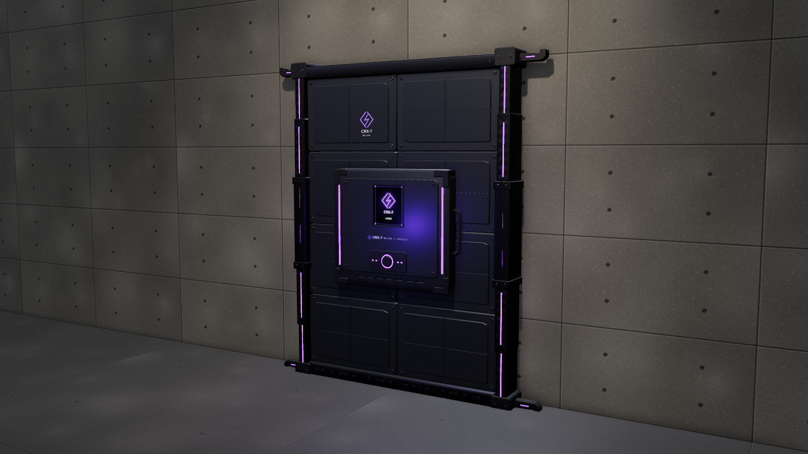

# gunmodls

Procedural 3D models built with [three.js](https://threejs.org) and exported as binary glTF (`.glb`).
Each model has an interactive viewer, real-world dimensions, named parts and working moving parts.

| Model | Category | Files |
| --- | --- | --- |
| [Mossberg 590A1](shotguns/m590a1/) | Shotguns | `m590a1.glb`, `shell-12ga.glb` |
| [AK-47 (AKM)](rifles/ak47/) | Rifles | `ak47.glb`, `cartridge-7.62x39.glb` |
| [CRX-7 Wallseal](gadgets/crx7-wallseal/) | Gadgets | `crx7-wallseal-{small,standard,large,xl}.glb` |




## Layout

```
<category>/<model>/
  <model>.glb      the model at real-world scale
  *.glb            accessories that ship with it (ammunition and similar)
  viewer.html      interactive viewer; also the procedural source the .glb files are exported from
  preview.png      still render
  README.md        specs, parts and notes
tools/             export, preview and inspection scripts
```

Folder names are lowercase and hyphenated: a plural category (`shotguns`, `rifles`, `pistols`, `gadgets`)
and a model id without spaces (`m590a1`).

## Conventions

- **Units:** metres, real-world size.
- **Axes:** glTF standard. +Y is up and the muzzle points toward +Z, so the right side faces -X.
- **Origin:** on the bore axis, directly above the trigger.
- **Parts:** every mesh is named after its part (`receiver`, `barrel`, `forend`, ...). Parts that move
  sit in their own node (`forend_assembly`, `bolt_assembly`), and actions ship as animation clips
  (`rack`).
- **Materials:** PBR metal/roughness, named by role (`barrel_steel`, `receiver_finish`, `polymer`, ...).
  The viewers add a fine procedural grain on top; that shader is not stored in the `.glb`.

## Viewing

- Open a model's `viewer.html` in a browser. It loads three.js from jsDelivr, so it needs a connection.
- Drop a `.glb` into any glTF viewer, for example <https://gltf-viewer.donmccurdy.com>, or import it
  into Blender with File > Import > glTF 2.0.

Playing an action in three.js:

```js
const gltf = await new GLTFLoader().loadAsync('shotguns/m590a1/m590a1.glb');
scene.add(gltf.scene);
const mixer = new THREE.AnimationMixer(gltf.scene);
const rack = mixer.clipAction(THREE.AnimationClip.findByName(gltf.animations, 'rack'));
rack.setLoop(THREE.LoopOnce).play();
// every frame: mixer.update(deltaSeconds)
```

## Rebuilding the files

The `.glb` files and previews are generated from the viewers. Install the tools once:

```bash
cd tools && npm install && npx playwright install chromium && cd ..
```

Then, from the repo root:

```bash
node tools/export-glb.js shotguns/m590a1/viewer.html
```

```bash
node tools/render-preview.js shotguns/m590a1/viewer.html
```

```bash
node tools/check-glb.js shotguns/m590a1/m590a1.glb
```

`export-glb.js` writes the `.glb` files next to the viewer, `render-preview.js` writes `preview.png`,
and `check-glb.js` loads a `.glb` with three.js's GLTFLoader and prints its size, parts, materials
and animations (add `--render out.png` to see it on its own).

## Adding a model

1. Create `<category>/<model>/viewer.html`. Copying an existing viewer is the quickest start.
2. The viewer must expose `window.__model = { id, ready, exportGLB(), preview() }`. `exportGLB()`
   returns the files to write; `preview()` hides the UI and draws one frame for the still.
3. Run the three tools above, write the model's `README.md`, and add a row to the table here.
