# gunmodls

Procedural 3D models built with [three.js](https://threejs.org) and exported as binary glTF (`.glb`).
Each model has an interactive viewer, real-world dimensions, named parts and working moving parts.

| Model | Category | Files |
| --- | --- | --- |
| [Mossberg 590A1](shotguns/m590a1/) | Shotguns | `m590a1.glb`, `shell-12ga.glb` |
| [AK-47 (AKM)](rifles/ak47/) | Rifles | `ak47.glb`, `cartridge-7.62x39.glb` |
| [Wall Fortification](gadgets/wall-fortification/) | Gadgets | `wall-fortification-{small,standard,large,xl,hatch}.glb` |
| [Breach Spider](gadgets/breach-spider/) | Gadgets | `breach-spider.glb` (spider, lance, kerf, effect locators), sounds, effect textures |
| [Recon Tablet](gadgets/recon-tablet/) | Gadgets | `recon-tablet.glb` (left-hand scanner), sounds, Unity ability script |
| [Conductive Lattice](gadgets/conductive-lattice/) | Gadgets | `conductive-lattice-node.glb` (thrown wall electrification; circuit grown at runtime), sounds |
| [Cameras](gadgets/cameras/) | Gadgets | `security-camera.glb`, `sticky-camera.glb`, sounds |
| [Tactical Phone](gadgets/tactical-phone/) | Gadgets | `tactical-phone.glb` (rugged 5.8" phone, the tablet's sibling: TPU overmould on an alloy frame, bonded display, replaceable L-shaped corner bumpers on Torx screws, knurled grip inlays, PTT key, thermal camera; 20-cell screen atlas), sounds, Unity script |
| [Tactical Tablet](gadgets/tactical-tablet/) | Gadgets | `tactical-tablet.glb` (rugged 8" tablet, the phone's construction at tablet scale: TPU overmould on an alloy frame, replaceable corner bumpers, battery door, hand strap, PTT key, thermal camera; tablet-layout 20-cell screen atlas), sounds, Unity script |
| [Scout Drone](gadgets/scout-drone/) | Gadgets | `scout-drone.glb` (thrown four-wheel recon drone: deploy, drive, turn, hop, shutdown), sounds, Unity driver |
| [Tracker Tags](gadgets/tracker-tags/) | Gadgets | `tracker-tag.glb`, `tracker-tags-pack.glb` (Nox: vibration-sensing tags and their dispenser), sounds, Unity script |
| [Nullfield](gadgets/nullfield/) | Gadgets | `nullfield-emitter.glb` (N1CK: thrown emitter, 4 m sensor-blind bubble), sounds, Unity script and feed helper |
| [N1CK](operators/n1ck/) | Operators | `n1ck.glb` (sleek painted-armour robot operator with tactical gear: Humanoid rig, LED face screen with an expression atlas, 9 clips), Unity skinned LOD copy, textures, Unity script and Avatar builder |
| [N1CK v1](operators/n1ck-v1/), [N1CK v2](operators/n1ck-v2/) | Operators | Archived earlier N1CK versions (v1 forged iron, v2 painted armour with the framed screen head), same files as above |
| [Human Rig](operators/human-rig/) | Operators | `human-rig.glb` (realistic human base rig with 24 swappable tactical gear modules on one Humanoid skeleton: plate carrier, helmet, battle belt, rifle and pistol mag pouches, IFAK, radio, drop-leg and belt holsters, sling, headset, glasses, flashbangs; loadout presets, 8 clips incl. pistol draw and reload, 3 LODs), Unity LOD copy, textures, Unity script and Avatar builder |
| [Uplink Server + Laptop](objectives/uplink/) | Objectives | `uplink-server.glb` (18U rack server, the bomb-site objective: door, port shutter, drive LED race, 5 clips) and `uplink-laptop.glb` (bulky rugged laptop, the defuser: cable reel, plug, screen atlas, 7 clips), sounds, Unity LOD copies, `UplinkServer.cs` + `UplinkLaptop.cs` |
| [Haneul Furniture Pack](props/haneul-furniture/) | Props | 64 breakable furniture pieces for Haneul Tower (incl. a CEO office set, server racks and hardware, piano, aquarium, vending machine and more), one GLB each (`glb/<id>.glb`): separate parts, pre-cut chunks, debris and `col_*` collision proxies, `parts.json`, catalogue, Unity copies and `BreakableFurniture.cs` |
| [Haneul Tower](maps/haneul-tower/) | Maps | 3-floor Siege-style map in the top of a 2111 Seoul supertall: `haneul-tower.glb` with typed surfaces (hard, breakable + reinforceable, hatches, glass, barricades), floor plans, `layout.json`, one-mesh city backdrop, Unity copy, `HaneulTowerMap.cs` + editor setup. No furniture: place pieces from the furniture pack |

Open `index.html` to browse every model in one page: pick one at the top, or press F2 for the next
(Shift+F2 for the previous). Each model runs in its own viewer with its animations and sounds.

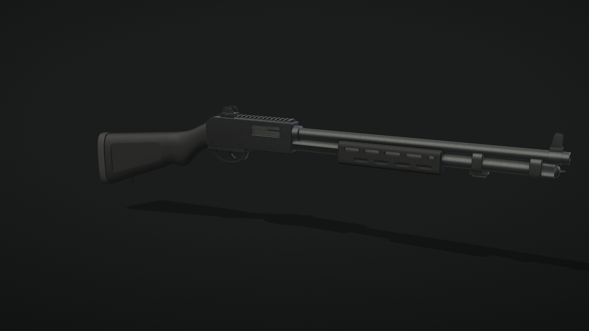

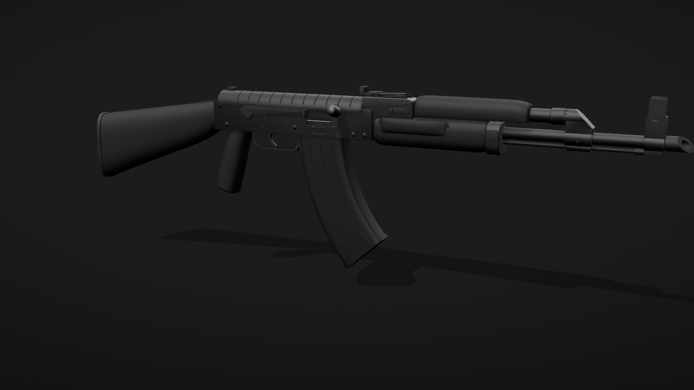

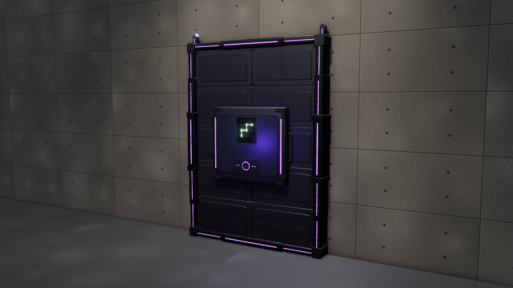

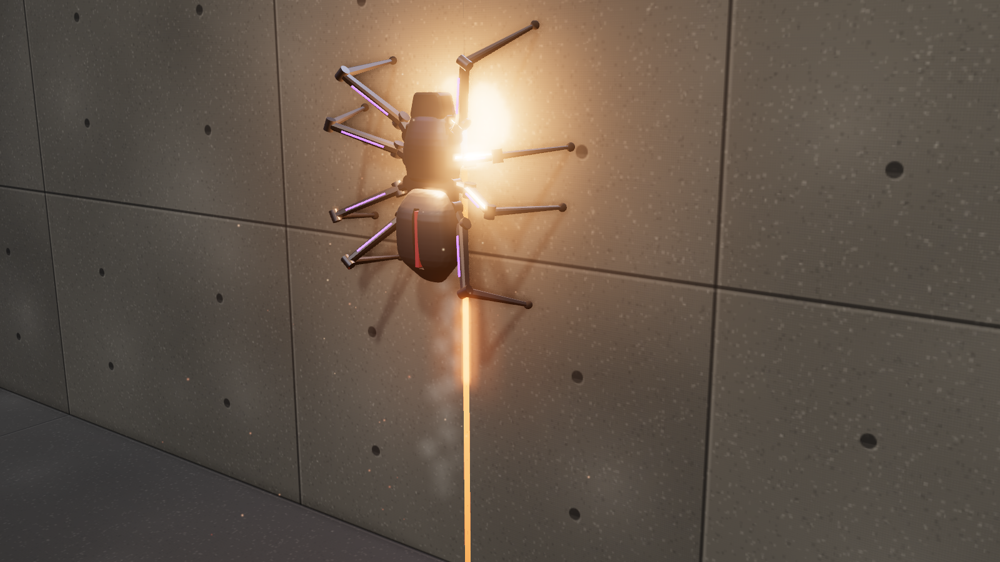

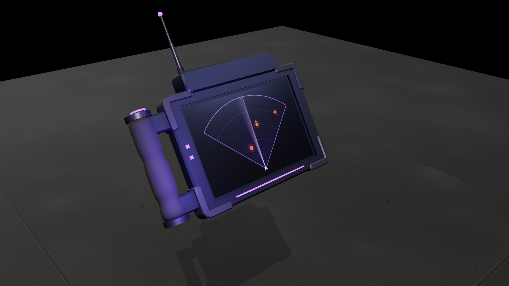

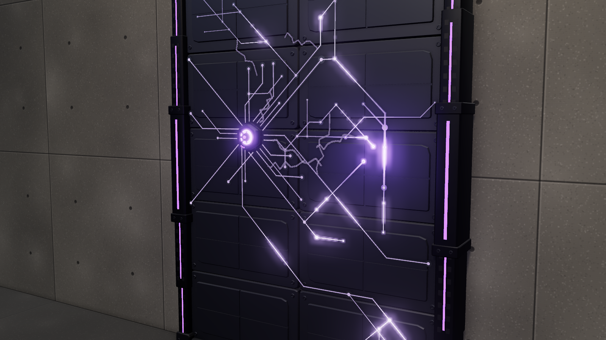

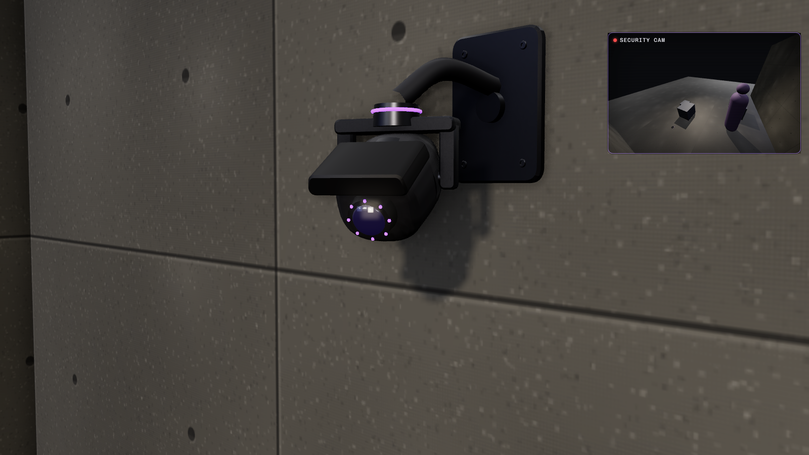

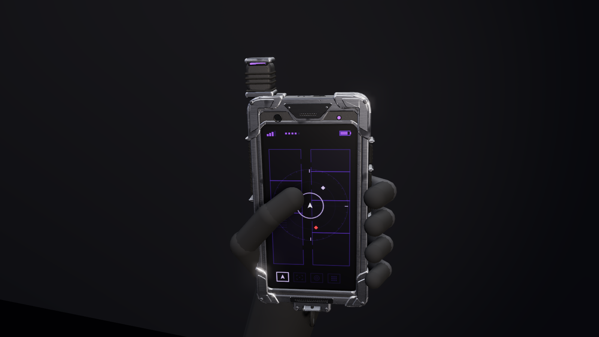

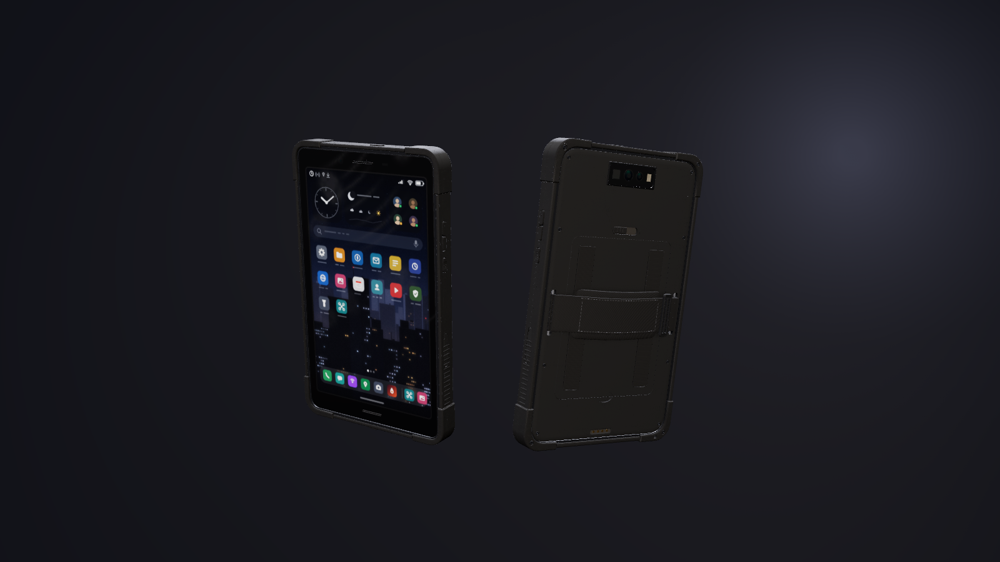

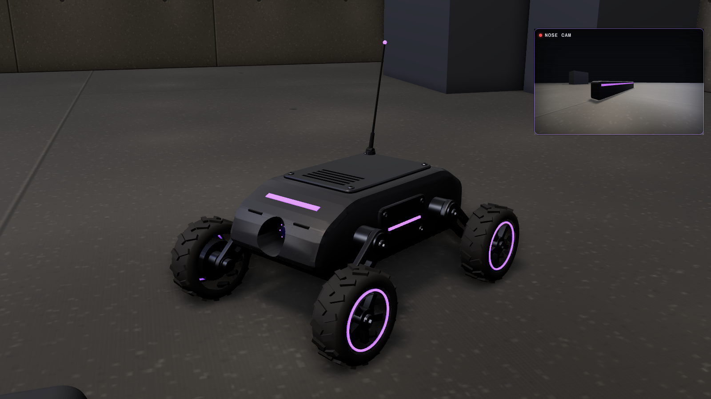


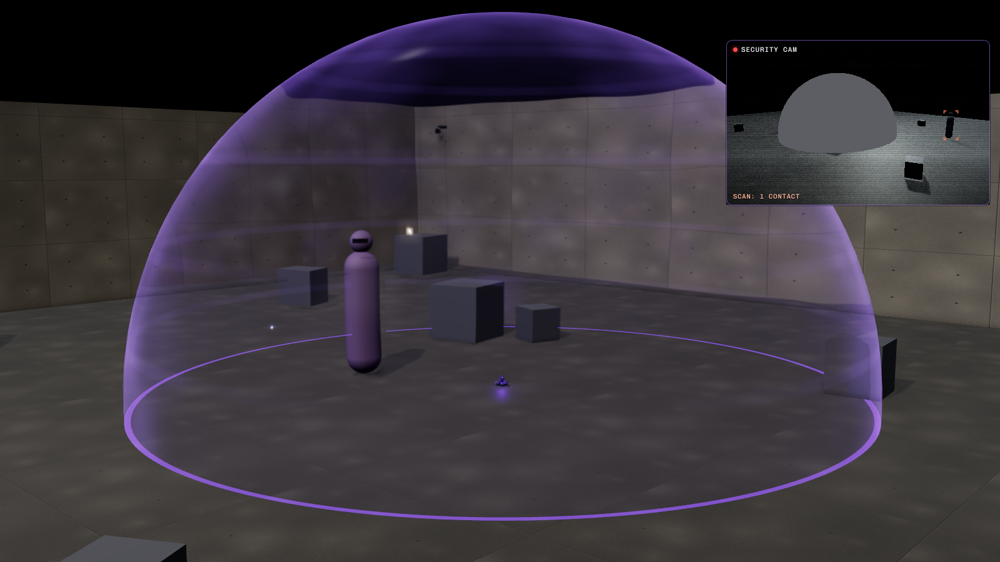

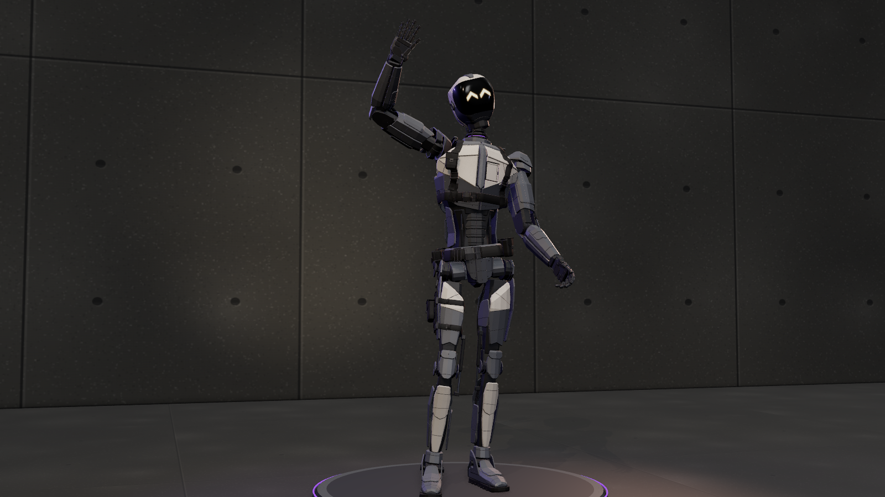

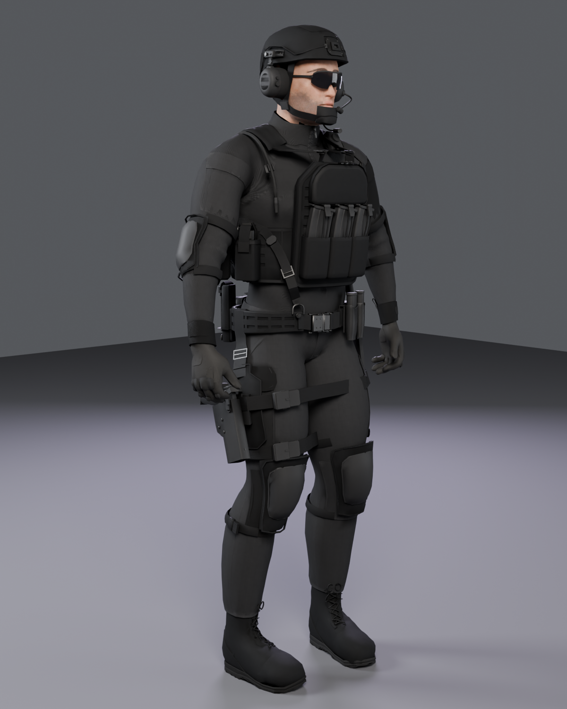

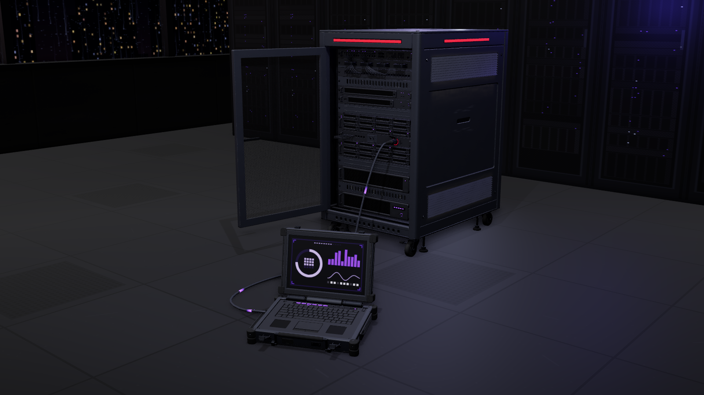

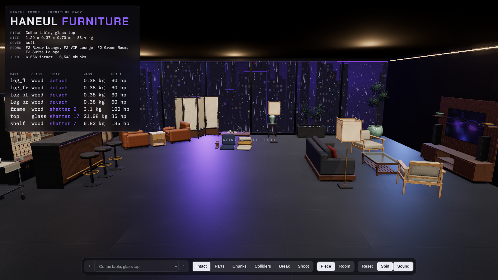

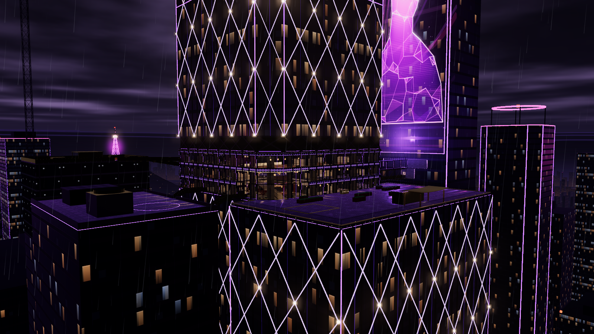

## Layout

```
<category>/<model>/
  <model>.glb      the model at real-world scale
  *.glb            accessories that ship with it (ammunition and similar)
  viewer.html      interactive viewer; also the procedural source the .glb files are exported from
  preview.png      still render
  README.md        specs, parts and notes
tools/             export, preview and inspection scripts
```

Folder names are lowercase and hyphenated: a plural category (`shotguns`, `rifles`, `pistols`, `gadgets`)
and a model id without spaces (`m590a1`).

## Conventions

- **Units:** metres, real-world size.
- **Axes:** glTF standard. +Y is up and the muzzle points toward +Z, so the right side faces -X.
- **Origin:** on the bore axis, directly above the trigger.
- **Parts:** every mesh is named after its part (`receiver`, `barrel`, `forend`, ...). Parts that move
  sit in their own node (`forend_assembly`, `bolt_assembly`), and actions ship as animation clips
  (`rack`).
- **Materials:** PBR metal/roughness, named by role (`barrel_steel`, `receiver_finish`, `polymer`, ...).
  The viewers add a fine procedural grain on top; that shader is not stored in the `.glb`.

## Unity

Every model has a `unity/` folder with game-ready copies of its `.glb` files, made by
`node tools/unity-export.js <model.glb> [...]`, for example
`node tools/unity-export.js gadgets/scout-drone/scout-drone.glb` (the Wall Fortification adds
`--sealed --drop terminal`). It writes into the `unity/` folder next to each source file; rerun it after
re-exporting a model. The copies have:

- meshes merged per moving part, one sub-mesh per material, welded and indexed;
- UV0 on every mesh: box projection in metres (1 UV unit = 1 m), for tiling detail or wear textures
  (the screen keeps its own UVs);
- three LODs per mesh, as children named `<part>_LOD0`, `_LOD1`, `_LOD2` (roughly 100 / 45 / 15 % of
  the triangles);
- box colliders as invisible children named `<part>_COL`;
- the same animation clips and node names as the main file.

The Wall Fortification also ships `<size>-sealed.glb`: the locked wall baked into one static mesh
without the terminal. Play `deploy` and `eject` on the animated prefab, then swap in the sealed prefab.

To use them:

1. Install glTFast: Package Manager > Add package by name > `com.unity.cloud.gltfast`.
2. Copy `unity/Editor/GunmodlsPrefabBuilder.cs` into an `Editor` folder in your project.
3. Copy the `unity/` .glb files you want into your project. In each one's import settings, set
   Animation to Legacy (or Mecanim) if you need the clips.
4. Select them (or their folder) and run Tools > Gunmodls > Build Prefabs From Selection. Each prefab
   gets a LODGroup and BoxColliders. Running it again overwrites the prefab, so components you added to
   it (such as `ScoutDrone`) and the fields you set on them are lost: use Copy Component before
   rebuilding and Paste Component As New after.

The Breach Spider's effects and timing come with a reference player: add `unity/Runtime/BreachSpiderFx.cs`
to your project and see `gadgets/breach-spider/INTEGRATION.md`. The Recon Tablet's ability is `unity/Runtime/ReconTablet.cs`
(see `gadgets/recon-tablet/INTEGRATION.md`). The lattice runs on `unity/Runtime/ConductiveLattice.cs` and the cameras on
`unity/Runtime/DeviceCamera.cs`. The Scout Drone drives with `unity/Runtime/ScoutDrone.cs` (see `gadgets/scout-drone/INTEGRATION.md`). Nox's tags run on `unity/Runtime/TrackerTags.cs` and N1CK's bubble on `unity/Runtime/Nullfield.cs`, which the tags need (sensors ask `Nullfield.IsHidden` before reporting anything). N1CK himself runs on `unity/Runtime/N1CK.cs`, with `unity/Editor/N1CKAvatarBuilder.cs` for a Humanoid Avatar (see `operators/n1ck/INTEGRATION.md`). The Human Rig runs on `unity/Runtime/HumanRig.cs`, with `unity/Editor/HumanRigAvatar.cs` for its Humanoid Avatar (see `operators/human-rig/INTEGRATION.md`). The uplink objective runs on `unity/Runtime/UplinkServer.cs` and `unity/Runtime/UplinkLaptop.cs` (see `objectives/uplink/INTEGRATION.md`). The Tactical Phone runs on `unity/Runtime/TacticalPhone.cs` (see `gadgets/tactical-phone/INTEGRATION.md`), the Tactical Tablet on `unity/Runtime/TacticalTablet.cs` (see `gadgets/tactical-tablet/INTEGRATION.md`). Furniture pieces break with `unity/Runtime/BreakableFurniture.cs` (see `props/haneul-furniture/INTEGRATION.md`). The map sets itself up with `unity/Runtime/HaneulTowerMap.cs` and **Tools > Gunmodls > Set Up Haneul Tower Map** (see `maps/haneul-tower/INTEGRATION.md`).

glTFast converts glTF's right-handed axes to Unity's by negating X, so any x coordinate quoted in these
docs (glTF space) has its sign flipped in a prefab's local space.

Materials import as glTFast PBR materials with emissive LEDs (enable Bloom in your post-processing to
make them glow). The fine surface grain seen in the viewers is not part of the files.

## Viewing

- Open a model's `viewer.html` in a browser. It loads three.js from jsDelivr, so it needs a connection.
- Drop a `.glb` into any glTF viewer, for example <https://gltf-viewer.donmccurdy.com>, or import it
  into Blender with File > Import > glTF 2.0.

Playing an action in three.js:

```js
const gltf = await new GLTFLoader().loadAsync('shotguns/m590a1/m590a1.glb');
scene.add(gltf.scene);
const mixer = new THREE.AnimationMixer(gltf.scene);
const rack = mixer.clipAction(THREE.AnimationClip.findByName(gltf.animations, 'rack'));
rack.setLoop(THREE.LoopOnce).play();
// every frame: mixer.update(deltaSeconds)
```

## Rebuilding the files

The `.glb` files and previews are generated from the viewers. Install the tools once:

```bash
cd tools && npm install && npx playwright install chromium && cd ..
```

Then, from the repo root:

```bash
node tools/export-glb.js shotguns/m590a1/viewer.html
```

```bash
node tools/unity-export.js shotguns/m590a1/m590a1.glb shotguns/m590a1/shell-12ga.glb
```

```bash
node tools/render-preview.js shotguns/m590a1/viewer.html
```

```bash
node tools/check-glb.js shotguns/m590a1/m590a1.glb
```

`export-glb.js` writes the `.glb` files next to the viewer, `unity-export.js` writes their game-ready
copies into `unity/` (see Unity above), `render-preview.js` writes `preview.png`,
and `check-glb.js` loads a `.glb` with three.js's GLTFLoader and prints its size, parts, materials
and animations (add `--render out.png` to see it on its own).

## Adding a model

1. Create `<category>/<model>/viewer.html`. Copying an existing viewer is the quickest start.
2. The viewer must expose `window.__model = { id, ready, exportGLB(), preview() }`. `exportGLB()`
   returns the files to write; `preview()` hides the UI and draws one frame for the still.
3. Run the three tools above, write the model's `README.md`, and add a row to the table here.
