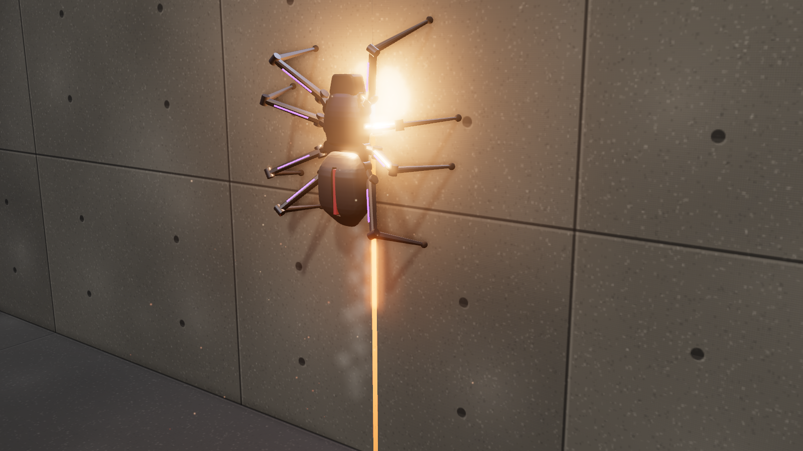

# Breach Spider

A thrown, eight-legged breaching drone in the house style. It lands at the bottom-left of a wall,
unfolds, cuts an upside-down U (a 1.0 × 1.8 m doorway) into the wall with a thermal lance as it walks
up, across and down, walks to the middle of the panel, arms and blows the panel out.

The viewer shows it on a temporary concrete test wall that breaks apart. That wall is only for the
showcase and is not in the exported files.

## Files

| File | Contents |
| --- | --- |
| `breach-spider.glb` | The spider with named parts, the lance beam, the kerf segments and effect locators. Clips: `deploy` (0.8 s) and `breach` (9.3 s). |
| `unity/breach-spider.glb` | Game-ready copy (merged meshes, UVs, LODs, colliders). |
| `sounds/` | `breach.wav` (the whole sequence), one-shots, `cues.json`, `generate_sounds.py`. |
| `fx/` | Particle textures, `breach-fx.json` and the scripts that make them. |
| `INTEGRATION.md` | How the clips, effects and sounds fit together, and what the game has to do. |
| `viewer.html` | Interactive viewer and the procedural source of the `.glb`. |

## Specs

| | |
| --- | --- |
| Size | 0.34 m body, about 0.55 m across the legs |
| Legs | 8, three joints each, alternating tetrapod gait, magnetic pads |
| Cut | 1.0 m wide × 1.8 m tall upside-down U, at 1 m/s |
| Sequence | deploy 0.8 s, cut about 5.4 s, walk to centre, arm 1.3 s, detonate at 10.1 s |

## Viewer

**Breach** (B or Space) throws the spider and runs the whole sequence; press it again to reset the
wall. **Pause** (P), **Slow-mo** (L, quarter speed), views including **Close** and **Far side** (where
the panel lands), orbit and sound (S).
