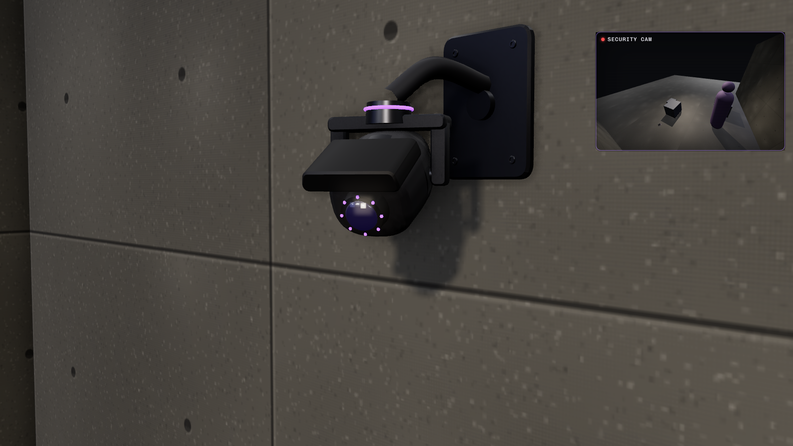

# Cameras

Two observation devices in the house style:

- **Security camera**: the building's fixed camera. A wall plate, a curved arm, a pan collar and a tilt
  yoke carrying a weatherproof head with a sun visor, a wide lens, an IR ring and a rec light.
  Pan ±70°, tilt -60° to +20°.
- **Sticky camera**: a thrown puck that grips a surface; its lid lifts and a lens ball rises on a mast
  and turns all the way round. Pan 360°, tilt -10° to +80°.

## Files

| File | Contents |
| --- | --- |
| `security-camera.glb` | Origin at the centre of the wall plate on the wall, wall normal +Z, looks +Z at rest. Nodes `mount` > `pan` (turn about Y) > `tilt` (turn about X) > `head_lens_assembly/fx_lens`. Clip `boot_sweep` (3 s: one look around). |
| `sticky-camera.glb` | Origin at the centre of the base on the surface, surface normal +Y, looks +Z at rest. Nodes `base` > `lid`, `mast` > `pan` > `tilt` > `ball_lens_assembly/fx_lens`. Clip `deploy` (0.6 s: lid lifts, mast rises; play backwards to close). |
| `unity/*.glb` | Game-ready copies (merged meshes, UVs, LODs, colliders). |
| `sounds/` | `servo_loop`, `boot`, `sticky_throw`, `sticky_land`, `sticky_open`, `feed_static`, and the generator. |
| `viewer.html` | Both cameras in a room corner with a live feed from the selected one. |

`fx_lens` is the view point: a camera there looking along the node's +Z sees what the device sees
(about 92° field of view looks right). Aim by turning `pan` and `tilt`; rest pose is pan 0, tilt 0.

## In Unity

Add `unity/Runtime/DeviceCamera.cs` to the prefab root. It finds `pan`, `tilt` and `fx_lens`, puts a
Camera on the lens rendering into a RenderTexture for the feed, turns the servos at a set speed with
the servo sound, and has `Aim`, `Look`, `Deploy` (sticky cam) and `Destroyed` (cuts the feed). Set the
limits per camera: security pan -70..70, tilt -60..20; sticky pan -180..180, tilt -10..80.

## Viewer

Pick **Security cam** (1) or **Sticky cam** (2). Drag the feed or use the arrow keys to aim; **Auto-sweep** (A)
pans on its own. **Throw** (D) throws the sticky cam onto the floor, where it opens; press again to close it.
