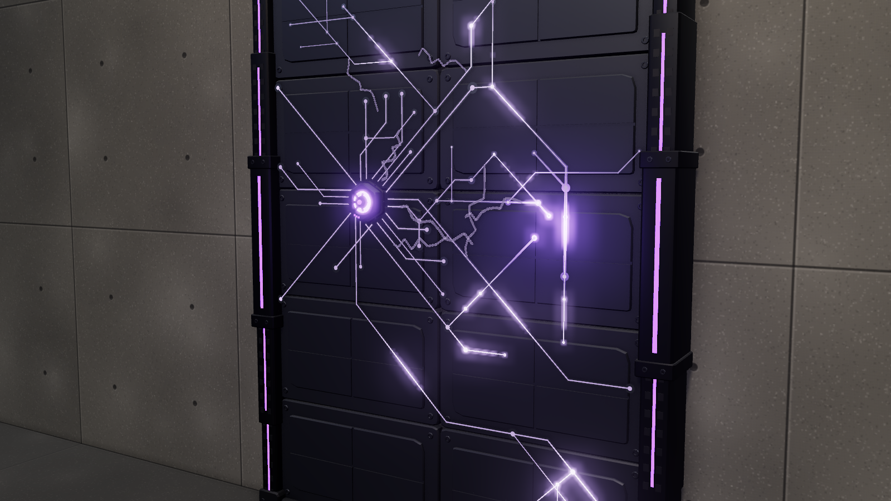

# Conductive Lattice

A wall electrification gadget. The defender throws a hex capacitor node at any point on their side of a
wall; it sticks, sprays liquid metal that runs out from it as a circuit of traces and pads, and cures. The
circuit stays inside a 2 × 2 m square centred on the node (±1 m across and up the wall) and stops at the
wall's edges. From then on the lattice pulses: live for 1 s (glowing traces, crawling arcs), off for 2 s. It
works on a soft wall and over the Wall Fortification; shooting the node kills the whole lattice.

The circuit is not baked: it is generated where the node lands, so every throw gives a different pattern
that fits the spot (in a corner it only grows into the wall). How long it sprays depends on the pattern, so
it usually goes live 2.6–3.8 s after it sticks.

## Files

| File | Contents |
| --- | --- |
| `conductive-lattice-node.glb` | The node, with its `deploy` clip (2.93 s). Clip time 0 is contact: the body starts 1 cm off the wall and seats by 0.35 s, the spray head turns three times from 0.40 s to 2.23 s, then it holds. The clip is a fixed length, timed for 1.6 m of spray. Origin at the contact point on the wall, facing +Z (out of the wall). |
| `unity/conductive-lattice-node.glb` | Game-ready copy (merged meshes, UVs, LODs, two box colliders: `lattice_node_COL` on the body and `spray_head_COL` on the spray head). |
| `sounds/` | `deploy` (4.4 s), `pulse` (1.35 s), `idle` (2 s loop), `power_down` (1.25 s), and `generate_sounds.py`. |
| `INTEGRATION.md` | How it works in game, how to wire it up in Unity, and how to change and rebuild it. |
| `viewer.html` | Interactive viewer (soft wall and reinforced, with the real Wall Fortification) and the procedural source of the node and the circuit generator. |

The .glb holds only the node. In Unity the circuit is grown at runtime by `unity/Runtime/ConductiveLattice.cs`
(at the repo root), which also needs a metal, a glow and an arc material: see `INTEGRATION.md`.

## Viewer

Click anywhere on the wall to throw a node there; **Throw** (D or Space) throws at a demo spot or clears
the wall. **Soft wall** (1) / **Reinforced** (2) switch the surface. **Pulsing** (E) turns the power on or
off. Views ¾, Front, Close.
