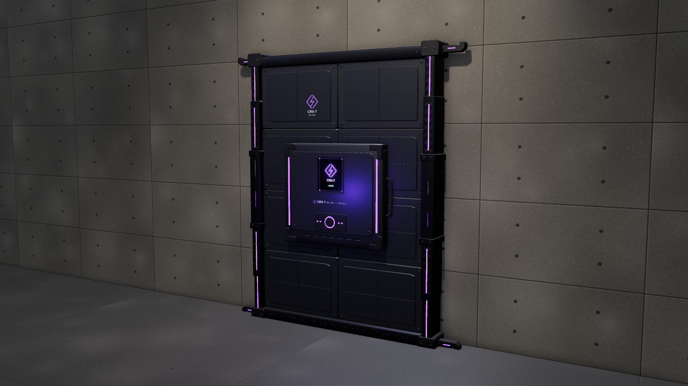

# CRX-7 "Wallseal"

Crystalix automated wall reinforcement. The operator places the base unit in the middle of a wall
and traces an arm pattern on its touch screen. After a press of the confirm button, the unit
expands into a reinforced wall:

1. Telescoping rails slide out sideways, then extend up and down.
2. Composite steel panels fan out between them.
3. Locking clamps swing into the wall frame.
4. Tie rods punch through the wall, and X-shaped star anchors twist-lock on the far side.

## Files

| File | Size (H × W) | Panels | Triangles |
| --- | --- | --- | --- |
| `crx7-wallseal-small.glb` | 1.0 × 1.0 m (doorway / narrow) | 2 × 2 | ~34k |
| `crx7-wallseal-standard.glb` | 2.0 × 1.5 m (single wall) | 4 × 2 | ~42k |
| `crx7-wallseal-large.glb` | 2.0 × 3.0 m (wide wall) | 4 × 4 | ~57k |
| `crx7-wallseal-xl.glb` | 3.0 × 3.0 m (bulkhead) | 6 × 4 | ~70k |
| `viewer.html` | Interactive viewer and the procedural source of the `.glb` files | | |

Panels share one mesh per file, so the files stay around 2 MB.

## Using it in a game

- **Units:** metres, +Y up. The unit faces +Z, away from the wall.
- **Origin:** bottom centre of the reinforced area, on the wall surface (z = 0). Put it on the
  defender side of the wall.
- **Rest pose:** fully deployed and locked.
- **Animation:** `deploy` (3.4 s) runs from the stowed base to the locked wall:
  - 0–0.35 s: confirm press
  - 0.45–1.85 s: rails spread and extend
  - 1.15–2.8 s: panels deploy
  - 2.5–3.35 s: clamps lock and anchors set

  Play it at the end of your touch-screen interaction, and play it backwards to retract.
- **Far side:** the star anchors and tie rods sit under the `far_side` node, set for a 0.3 m wall.
  Set that node's z to minus your wall's thickness.
- **Nodes:**
  - `core` (with `confirm_button`)
  - `rail_left` / `rail_right` (sleeves, `*_upper_n` / `*_lower_n` stages, clamps and jaws)
  - `post_centre` (large and XL only)
  - `beam_top`, `beam_bottom`
  - `panel_rR_cC`
  - `far_side` (`tie_rod_n`, `star_n`)
- **Materials:** PBR, with emissive purple LEDs and the screen. Every bolt has a hex socket recess.

## Viewer

Open `viewer.html`. **Deploy** (D or Space) plays the whole sequence, and pressing it again
retracts. There are size buttons (1–4), views including **Far side**, part labels and a slow orbit.
