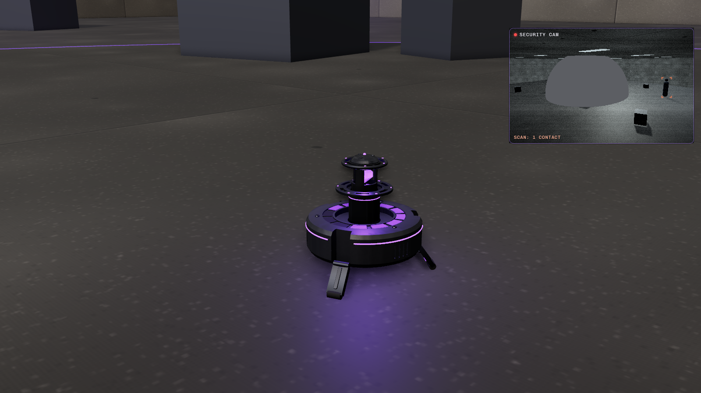

# Nullfield

N1CK's counter-recon gadget: a puck-sized emitter you throw. It lands folded on its belly, kicks out three
legs, raises a two-stage mast with a glowing core in a windowed lantern, and puts up a 4 m bubble. Inside the
bubble electronics read nothing: drone and camera feeds show a flat, noise-free patch, scanners and tracker
tags return nothing. Eyes still see everything. N1CK himself is always hidden from sensors, bubble or not.

The battery gives 25 s of field and recharges while the field is off; a 12-segment gauge on top shows the
charge. Two rings turn in opposite directions while the field is up. Shooting the emitter kills the bubble.
Dark alloy and composite, purple lights, hex screws, no markings.

13 cm across and 5.3 cm tall folded; standing it is 15 cm across and 13.7 cm tall with the mast up (7.9 cm
with it down). 21.6k triangles, 1k of them the bubble sphere.

## Files

| File | Contents |
| --- | --- |
| `nullfield-emitter.glb` | The emitter standing with the mast up, with its clips. Origin on the ground under the middle, front +Z (leg 0), up +Y. |
| `unity/nullfield-emitter.glb` | Game-ready copy (merged meshes, UVs, LODs, colliders). Driven in Unity by `../../unity/Runtime/Nullfield.cs`. |
| `sounds/` | `throw`, `land`, `deploy`, `field_on`, `field_loop`, `field_off`, `low_battery`, `shot` (44.1 kHz mono WAV), and `generate_sounds.py` that makes them. |
| `INTEGRATION.md` | How it works in game (the field, the battery, the tell, the counterplay), how to wire it and the sensors up in Unity, and how to change and rebuild it. |
| `viewer.html` | Interactive viewer (a room watched by a camera and a drone) and the procedural source. |

## Clips

| Clip | Length | What moves | Keys |
| --- | --- | --- | --- |
| `deploy` | 1.6 s | Starts folded on its belly: the legs spring out one after another and stand it up (by 0.6 s), then the `power_on` motion: the mast rises, the bubble grows to 4 m (1.05 to 1.55 s). | body, legs, mast stages, bubble |
| `idle` | 3 s loop | The lower ring and the core turn once anticlockwise (seen from above), the upper ring twice clockwise. Play it at a speed ramped 0 to 1 to spin up and down. | rings, core |
| `power_on` | 1.0 s | Standing with the mast down: the mast rises, the bubble grows to 4 m (0.45 to 0.95 s). Legs held out. | body, legs, mast stages, bubble |
| `power_off` | 0.8 s | Switched off or battery empty: the bubble collapses in 0.25 s, the mast sinks. Legs held out. | body, legs, mast stages, bubble |
| `shutdown` | 1.2 s | Shot: the bubble collapses in 0.12 s, the legs give way one by one and it sags, tilted. It does not move the mast: play `power_off` at 2.5× with it. | body, legs, bubble |

`fx_bubble` is a unit sphere at the core; its scale is the bubble radius in metres (rest scale 0.0001). The
twelve gauge segments are separate nodes (`gauge_00` … `gauge_11`) so a game can scale unlit ones to 0. Start
and end poses of every clip are in `INTEGRATION.md`.

## Viewer

It is thrown in on load and puts up its field. N1CK (purple) walks into the bubble and out again; a teammate
(blue) stands outside. The panel in the corner is a sensor feed with grain and scanlines: everything inside the
bubble is one flat grey patch, and N1CK is a flat silhouette wherever he is. A scan sweep every 3 s marks the
people the sensor can see; it never marks N1CK or anyone in the bubble.

**Throw / Pick up** (T), **Field** on or off (F), **Shoot emitter** (X), feed **Camera** or **Drone** (C),
views Room and Close, Sound. The gauge on the plate and the one on top of the model drain while the field is
up. When the battery runs out, the viewer switches the field back on once it has recharged fully, until you
use the Field or Shoot button. After a shot, Pick up gives you a fresh, full emitter.
