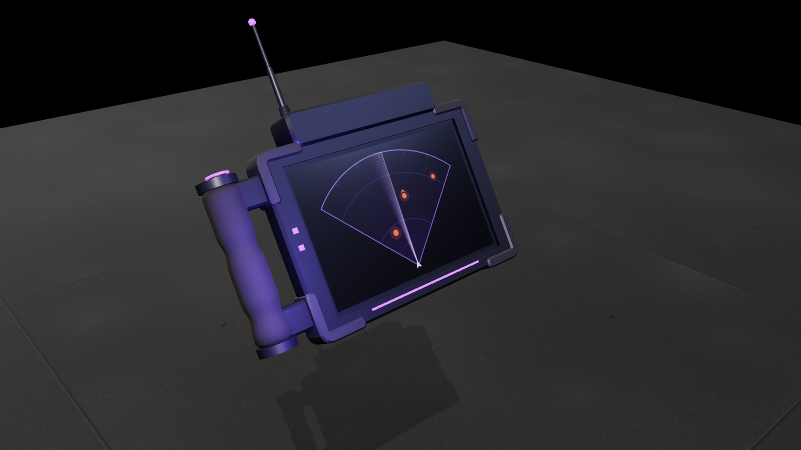

# Recon Tablet

A rugged left-hand scanner. The holder grips it by the side handle with the left hand, keeping the right
hand on the weapon, and the thumb presses the pulse button on top of the grip. Each pulse sweeps a
90-degree cone ahead of where the holder faces, 25 m deep and through walls, and the screen shows the
enemies inside it as blips that fade out, with a caret above or below for enemies on another floor.

## Files

| File | Contents |
| --- | --- |
| `recon-tablet.glb` | The tablet: 25 × 17 cm, about 18k triangles, named parts. Clips: `deploy` (0.75 s: the sensor bar flips up, the antenna extends) and `scan` (1.4 s: the thumb presses the button and the pulse fan flies out; nothing else moves). Play `deploy` backwards to stow. |
| `unity/recon-tablet.glb` | Game-ready copy (merged meshes, UVs, LODs, colliders). |
| `sounds/` | `power_on`, `power_off`, `scan`, `blip` and `generate_sounds.py`. |
| `INTEGRATION.md` | How the ability works and how to wire it up. |
| `viewer.html` | Interactive viewer with a live radar screen, and the procedural source of the `.glb`. |

## Parts

- `body`: `frame`, `screen` (UV 0..1, draw the radar into it), `screen_glass`, `bumpers`, `battery_pack`,
  `back_screws`, `grip`, `grip_brackets`, `grip_caps`, `pulse_button`, LEDs.
- `body/sensor_hinge`: the sensor bar; `sensor_emitter` (fixed) with `fx_sensor` and
  `fx_scan_cone` (the pulse fan, scaled out by `scan`); `antenna` with two telescoping stages.
- `grip_left_hand`: the palm position (the origin). The holder's left is +X, the sensor looks +Z and the
  screen faces -Z, toward the holder.

## Viewer

**Deploy** (D) raises the sensor and boots the screen; press again to stow. **Scan** (Space) sends a
pulse; **Auto-scan** (A) pulses every 2.5 s. Pretend enemies wander ahead so the screen has something to
show. Views: **Holder** (over the shoulder), ¾, **Front** (the sensor bar) and **Back**.
