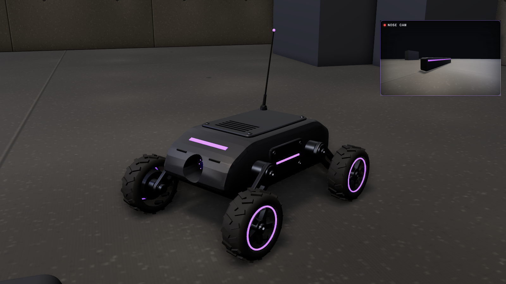

# Scout Drone

A thrown recon drone on four wheels. It lands on its belly folded up, swings its arms down and stands, then
drives around on skid steering with a wide camera in its nose. A thumper plate under the belly fires to hop
it over low cover (about 25 cm up). Dark alloy shell, purple lights, hex screws, no markings.

About 23 cm wide, 35 cm long and 13 cm tall at ride height (27 cm to the antenna tip); 35k triangles.

## Files

| File | Contents |
| --- | --- |
| `scout-drone.glb` | The drone at ride height with its clips. Origin on the ground under the middle, forward +Z, up +Y, left +X. |
| `unity/scout-drone.glb` | Game-ready copy (merged meshes, UVs, LODs, colliders). |
| `sounds/` | `throw`, `land`, `deploy`, `motor_loop`, `hop`, `shutdown`, and `generate_sounds.py`. |
| `INTEGRATION.md` | How it works in game and how to wire it up. |
| `viewer.html` | Interactive viewer (drive it around a room) and the procedural source. |

## Clips

| Clip | Length | What moves |
| --- | --- | --- |
| `deploy` | 1.2 s | Starts folded on its belly: the arms swing down and it stands up (the wheels roll in), the nose shutters open, the antenna flicks up. |
| `drive` | 0.6 s loop | Wheels two turns forward (0.9 m/s at speed 1), a little suspension bob, antenna leaning back. |
| `turn_left`, `turn_right` | 0.6 s loops | Skid turn on the spot: one side forward, the other back. |
| `hop` | 0.9 s | Crouch, the thumper fires at 0.14 s (take off), the arms hang in the air, touch down at 0.6 s and soak it up. |
| `shutdown` | 0.9 s | Destroyed or picked up: sags onto its belly, shutters close, antenna droops. |

## Viewer

It is thrown in on load and patrols a loop, hopping the low barrier. **WASD** or the arrow keys drive it
yourself, **Space** hops, **Throw / Pick up** (T) throws it or folds it up, **Patrol** (P) hands it back to the
loop. The feed in the corner is its nose camera. Views Follow, Close and Room.
