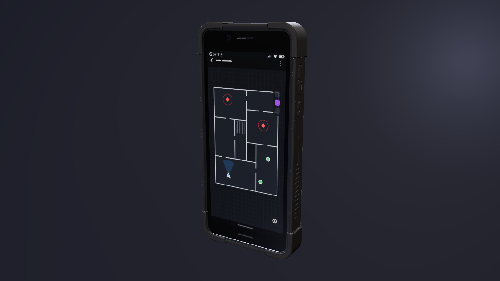

# Tactical Phone

A rugged operator smartphone, built like the real IP68 / MIL-STD rugged phones it is modelled on (Sonim XP10,
Kyocera DuraForce Ultra 5G, Samsung Galaxy XCover6 Pro, Cat S62 Pro). It is the phone of the family whose 8" member
is the [Tactical Tablet](../tactical-tablet/): the same materials, screws, keys, flap, cameras and screen UI.

- **Construction (shared with the tablet):** an aluminium mid-frame (bead-blasted, near-black satin anodise) inside one
  TPU overmould that wraps the whole perimeter: a front lip 0.6 mm proud of the glass, side walls with moulded grip
  ribs, a back rim. The frame shows only as a 1.8 mm chamfered ring round the glass and round the back cover. Four
  replaceable L-shaped TPU corner bumpers (legs about 10 mm past the corner radius) key into the overmould: a constant
  1.0 mm proud of it with no swell, a 0.3 mm part line with a dark floor, 0.45 mm chamfered leg ends, and one Torx
  screw each from the back, flush in a Ø3.4 mm counterbore. The bumpers are moulded a touch darker and glossier than
  the overmould, so the split reads through the material. A crowned near-black glass-filled nylon back cover (a fine
  bead-blast texture) is held by six Torx screws in counterbores.
- **Front:** a flat 0.9 mm cover glass with a 2.5D edge (a faint clearcoat reflection, a few prints) with the 5.8" 18:9
  panel optically bonded under it: the black ink and the panel sit 0.1 mm under the front face, so there is no
  parallax and no grey rim, and the ink runs up to the active area (3 mm corner radius). Top bezel: the earpiece slot
  (a dark acoustic mesh 0.5 mm under the glass), the front camera, two near-invisible light / proximity windows and an
  unlit status LED window (no punch-hole: the rugged norm). Bottom bezel: one 14 × 1.2 mm loudspeaker slot through
  the glass over a dark mesh.
- **Left side (holder's left):** the domed push-to-talk key in a moulded guard rim, with four moulded half-round ribs
  (0.4 mm high, 1 mm wide, 2.2 mm pitch). It carries the only accent colour, the family's shared PTT violet `#6234d4`
  (a matte pigment, not a light, that renders close to `#8a4dff` after tonemapping). Below it sits a programmable key
  (the scan key).
- **Right side:** power key with a concave knurled face, separate volume up / down keys (up has a tactile nub), a SIM /
  microSD tray as its own part with an eject pinhole.
- **Edges:** USB-C (a darkened stainless receptacle 6.5 mm deep, tongue, contacts) behind a sealed TPU flap with seal
  lip, plug, pull tab with a nail notch and a living-hinge strap; a sealed 3.5 mm audio port (TPU plug with a pull
  nub) and a noise-cancelling mic on the top edge, a mic on the bottom; a lanyard slot in the bottom corner bumper.
- **Back:** a black anodised camera deco ring with one black clearcoated cover glass over the tablet's camera grammar,
  left to right: a square germanium thermal window, the round main lens and the round wide lens (dark barrel ring,
  domed front element with a blue-violet AR coat, dark iris) and a rectangular off-white Fresnel flash (opaque, never
  lit at rest). Below it: the rear speaker grille (hex hole pattern), two diamond-knurl TPU grip inlays along the long
  edges where the fingers and palm sit (the tablet's grip strips at phone scale), pogo dock pads. No strap hardware:
  a lanyard goes through the bumper slot, a holster grips the body.
- **Surfaces and wear:** one fine uniform mould texture on the TPU (no leather grain, no blotches), black-oxide screws
  darker and glossier than the cover, prints on the glass.

No text, logo or digit anywhere, including the screen (an analog clock stands in for the time).

## Files

| File | Contents |
| --- | --- |
| `tactical-phone.glb` | The phone: 80.8 × 169.2 mm over the bumpers, 16.8 mm deep at the camera ring, about 0.32 kg. 63.3k triangles, 25 materials, named parts, a 20-cell screen atlas (5 × 4, RGB PNG) and eight clips. The plain file shows the lock screen. |
| `unity/tactical-phone.glb` | Game-ready copy: meshes merged per node, LOD0/1/2 (63.3k / 28.8k / 15.8k triangles), a box collider on the body (none on the screen: taps go through `Tap(uv)`), the same clips. |
| `sounds/` | 15 WAVs (`wake`, `unlock`, `tap`, `scan`, `scan_result`, `alert`, `low_battery`, `power_off`, `button`, `flap_open`, `flap_close`, `draw`, `holster`, `ptt_chirp`, `ptt_release`) and `generate_sounds.py` (shared with the tablet). |
| `INTEGRATION.md` | Node names, clips, the atlas cells and their UV offsets, and the Unity setup. |
| `viewer.html` | Interactive viewer and the procedural source of the `.glb`. |
| `../../unity/Runtime/TacticalPhone.cs` | The Unity component: screen state machine, push-to-talk hold, thermal scan, LED tints, sounds, events, the USB flap, the torch and a live drone feed. |

## Parts

- **`body`** (static):
  - Shell: `body_frame`, `body_overmould`, `body_overmould_grip` (side ribs, PTT guard), `body_audio_plug`, `body_audio_floor`, `body_key_wells`, `body_bumpers`, `body_bumper_screws`, `body_bumper_floors`, `body_part_lines`, `body_sim_tray`, `body_sim_floor`.
  - Back: `body_back` (cover with the speaker holes, counterbores, grip pockets and pogo well), `body_back_grip`, `body_back_grip_seam`, `body_back_gap`, `body_back_screws`, `body_screw_counterbores`, `body_rear_speaker_mesh`, `body_pogo_pads`.
  - Cameras: `body_cam_deco`, `body_cam_glass`, `body_cam_mask`, `body_cam_floor`, `body_cam_lens_rings`, `body_cam_elements`, `body_cam_iris`, `body_thermal_bezel`, `body_thermal_window`, `body_flash_well`, `body_flash`.
  - Front: `screen_glass`, `body_glass_mask`, `body_speaker_slot_walls`, `body_speaker_grilles`, `body_speaker_backing`, `body_sensor_windows`, `body_cam_front_ring`, `body_cam_front`, `body_cam_front_coating`.
  - Port: `body_usb_shell`, `body_usb_back`, `body_usb_tongue`, `body_usb_contacts`, `body_usb_well_floor`.
- **Moving nodes:** `screen` (`screen_display`), `led_status`, `btn_power`, `btn_vol_up`, `btn_vol_down` (two separate keys), `btn_ptt` (cap and ribs), `btn_action` (programmable key), `flap_usb` (cover, seal, plug, tab, strap).
- **Locators:** `grip_left_hand` (attach socket: the palm on the back), `fx_touch`, `fx_ptt`, `fx_scan` / `cam_thermal`, `cam_rear`, `cam_front` (in the top bezel), `fx_flash`.
- **Axes:** +Y up the phone, the screen faces −Z (toward the holder), the holder's left is +X (glTF).

## Clips

| Clip | Seconds | What moves |
| --- | --- | --- |
| `idle` | 2.0, loop | nothing (the status LED stays off; the screen carries the state) |
| `wake` | 0.6 | power key press |
| `unlock` | 0.7 | nothing (the swipe is the character's) |
| `ptt` | 1.6 | PTT key pressed at 0.05 s, held to 1.4 s (loop 0.3–1.3 s while held) |
| `scan` | 1.2 | programmable key press; the LED flashes once at the lock-on (1.0–1.1 s) |
| `alert` | 1.0, loop | the status LED blinks at 4 Hz (tinted red): the only clip that keeps it lit |
| `power_off` | 1.2 | power key held |
| `flap_open` | 0.45 | USB-C flap swings 120° out of the bottom edge (play backwards to close) |

## Viewer

Clip buttons (keys 1–8), forced screen states, the idle app, Studio / Daylight / Night lighting (L), and Held / ¾ /
Front / Side / Back views. Click the glass for a tap. On a phone-width screen every control group gets its own line;
a group wider than the screen scrolls sideways and fades at the edge where more buttons wait. No glove or hand proxy: the phone is shown alone. three.js loads
from the jsDelivr CDN, as in every viewer in this repo.
