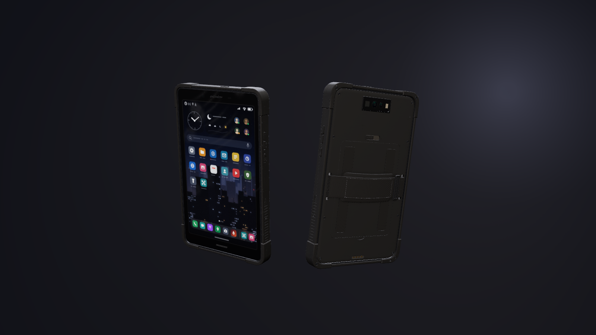

# Tactical Tablet

The 8-inch member of the Tactical Phone family: a rugged Android tablet built like the real enterprise devices in
this class (Galaxy Tab Active5, Zebra ET45, Getac ZX80, Panasonic FZ-L1; 8" 16:10, IP68 / MIL-STD-810H). It uses the
phone's construction part for part, at tablet scale: the same overmould, bumpers, Torx screws, keys, PTT guard, USB
flap, black-glass camera window, knurled grip inlays, materials and UI. Side by side they read as one product line.

- **Mid-frame:** CNC-machined 6063 aluminium, bead-blasted and hard-anodised near-black gunmetal (`#2c2e33`, satin,
  roughness about 0.42, a fine uniform grain only). It shows as a 2 mm band round the glass, with a 0.35 mm machined
  bright chamfer on its inner edge, and as a 1.6 mm band round the back cover. Its exposed chamfers carry a few bright
  chips where the anodise has worn through.
- **TPU overmould:** one moulding round the whole perimeter. Its front lip stands 0.6 mm proud of the glass. The side
  walls carry the key pockets, a moulded guard rim round the PTT key, and 14 grip ribs on each side over the lower half.
  Its texture is a fine mould stipple with a faint orange peel, roughness 0.74–0.84.
- **Corner bumpers (×4):** separate L-shaped TPU caps keyed into the overmould. They stand a constant 1.0 mm proud of
  the side walls and 0.6 mm proud front and back, with a 0.3 mm part line and a 0.45 mm chamfer round each leg's end.
  Each is held by one Torx screw (Ø2.8 mm head) from the back, in a counterbore. Their TPU is more scuffed than the
  overmould, because they take the drops. The bottom +X bumper has the lanyard bar: a slot down from the back meets a
  slot out of the bottom face.
- **Back cover:** crowned glass-filled nylon (PA-GF30) with a fine spark-erosion texture, held by eight Torx screws in
  counterbores over a gasket. It carries:
  - a removable **battery door** (88 × 112 mm, 0.3 mm gap all round) with two TPU grip inlays moulded with the phone's
    diamond knurl, a sliding latch above it (a ribbed slider in a slot, shown locked, with a moulded arrow toward the
    unlock end) and a finger scoop below it;
  - two recessed strap pockets with Ø1.5 mm stainless bars, which carry the hand strap;
  - pogo dock pads in a recessed well at the bottom;
  - the camera window at the top.
- **Hand strap:** 25 mm nylon webbing with a neoprene pad and a ladder-lock slider, looped round the strap bars. The
  left hand slides under it.

Every visible feature has a job and a real size:
- **Front:** a 0.9 mm cover glass with a 0.4 mm 2.5D edge, bezels 14.05 mm top and bottom and 6.15 mm at the sides. The
  panel's black-matrix border shows as a slightly lighter, more matte band inside the ink, so the active area reads.
  In each short bezel there is an 18 × 1.2 mm loudspeaker slot through the glass with a dark mesh behind it (stereo
  in landscape). The top bezel also holds the front camera (a dark anodised ring round a coated lens), an ALS /
  proximity window and the green status LED. The glass carries oily prints, thumb swipes over the lower third, a
  palm smear down the holder's left side and a wipe arc, in both its roughness and its clearcoat roughness, plus a
  faint grey haze. They show as blurred patches in reflections at grazing angles.
- **Left side (+X, under the left thumb):** the push-to-talk key, 22 × 6.4 mm, domed, with five raised ribs, in a
  moulded guard rim 0.6 mm proud of the wall. Its top stands only 0.15 mm above the rim, so a knock in a holster lands
  on the rim. It is the only accent colour: matte violet pigment `#6234d4` (the phone's `ptt_accent` value; it renders
  close to the house `#8a4dff`), not a light.
- **Right side (−X):** a concave power key with five glove grooves, two separate volume keys (the up key has a raised
  nub) and a SIM / microSD tray, which is its own nylon part with a 0.2 mm split line, an eject pinhole and a nail
  notch.
- **Top edge:** the programmable key (convex, with a locating dimple; the game's scan key) and two mic holes.
- **Bottom edge:** the USB-C receptacle (8.9 × 3.2 mm steel shell, 6.5 mm deep, with its tongue and contacts) behind a
  TPU flap, and a mic. The flap has a lid, a seal lip, a plug with a sealing rib, a 1.5 mm raised pull tab over a
  fingernail notch, and a living-hinge strap. It swings 100° and stays attached. The well floor round the port is a
  dusty dark grey.
- **Camera window (the phone's part, same size and layout):** a black anodised deco ring 42 × 16 mm, 0.7 mm proud of
  the cover and 0.2 mm inside the bumper line, with one black cover glass. Under the glass's printed mask, left to
  right: a square germanium thermal window (dark grey-green with a hard specular), the main and wide lenses (dark
  barrel rings, domed front elements with a blue-violet AR coat, dark irises), and a rectangular Fresnel flash lens.

Wear is light and real: scuffs in the bumper TPU, chips on the frame's exposed chamfers, grey dust in the screw
counterbores, the strap pockets, the latch slot, the pogo well and the USB well, and the prints on the glass. There is
no text, logo or digit anywhere, including the screen.

## Files

| File | Contents |
| --- | --- |
| `tactical-tablet.glb` | The tablet: **131.6 × 212.0 × 15.8 mm** over the bumpers (the strap stands about 6.2 mm above the back bumper line at its middle), about 0.6 kg. 65,195 triangles, 31 materials, 75 meshes, named parts, a 20-cell screen atlas (5 × 4) and eight clips (below). The plain file shows the lock screen. |
| `unity/tactical-tablet.glb` | Game-ready copy: meshes merged per node, LOD0/1/2 (65.2k / 30.0k / 16.1k triangles), three box colliders (`body_COL` 131.6 × 212 × 15.8 mm, `screen_COL`, `hand_strap_COL`) and the same clips. |
| `sounds/` | 15 WAVs (`wake`, `unlock`, `tap`, `scan`, `scan_result`, `alert`, `low_battery`, `power_off`, `button`, `flap_open`, `flap_close`, `draw`, `holster`, `ptt_chirp`, `ptt_release`) and `generate_sounds.py`. |
| `INTEGRATION.md` | Node names and positions, clips, the atlas cells and their UV offsets, colliders and the Unity setup. |
| `viewer.html` | Interactive viewer and the procedural source of the `.glb`. |
| `preview.png` | Front three-quarter (home screen) beside the back three-quarter. |
| `../../unity/Runtime/TacticalTablet.cs` | The Unity component. It covers the screen state machine, push-to-talk hold, thermal scan, LED tints, sounds, events, the touch trigger, the USB flap, the strap, the torch and a live drone feed. |

## Parts

- **`body`** (static):
  - Frame: `body_frame` (with `body_frame_wear` chips), `body_frame_chamfer`.
  - Overmould: `body_overmould`, `body_overmould_grip` (the PTT guard and the side grip ribs), `body_key_wells`,
    `body_mic_floors`, `body_sim_tray`, `body_sim_floor`.
  - Bumpers: `body_bumpers`, `body_bumper_screws`, `body_bumper_floors`, `body_part_lines`.
  - Back: `body_back` (the cover, with the pogo well, counterbores, strap pockets, door recess, latch slot, finger
    scoop and camera well cut in), `body_back_gap`, `body_back_screws`, `body_screw_counterbores`,
    `body_battery_door`, `body_battery_door_gap`, `body_back_grip` (the two knurled inlays), `body_back_grip_seam`,
    `body_battery_latch`, `body_latch_slot_floor`, `body_latch_arrow`, `body_strap_pockets`, `body_strap_bars`,
    `body_pogo_well`, `body_pogo_pads`.
  - Camera: `body_cam_deco`, `body_cam_glass`, `body_cam_mask`, `body_cam_floor`, `body_cam_lens_rings`,
    `body_cam_elements`, `body_cam_iris`, `body_thermal_bezel`, `body_thermal_window`, `body_flash_well`,
    `body_flash`.
  - Front: `screen_glass`, `body_glass_mask`, `body_panel_border`, `body_speaker_slot_walls`,
    `body_speaker_grilles`, `body_speaker_backing`, `body_cam_front_ring`, `body_cam_front`,
    `body_cam_front_coating`, `body_als_window`.
  - USB-C: `body_usb_shell`, `body_usb_back`, `body_usb_tongue`, `body_usb_contacts`, `body_usb_well_floor`.
- **Moving nodes:**
  - `screen` (the atlas plane `screen_display`) and `led_status` (`led_status_dot`, in the top bezel).
  - Keys: `btn_ptt` (`_cap`, `_ribs`), `btn_power` (`_cap`, `_knurl`), `btn_vol_down` (`_cap`), `btn_vol_up`
    (`_cap`, `_nub`) and `btn_action` (`_cap`, `_dimple`).
  - `flap_usb` (`_cover`, `_seal`, `_plug`, `_tab`, `_strap`).
  - `hand_strap` (`_band`, `_pad`, `_loops`, `_slider`, `_stitch`).
- **Locators:**
  - `grip_left_hand`: attach socket (no mesh): the palm on the battery door under the strap pad.
  - `fx_touch`: the thumb tap point on the glass.
  - `fx_scan`: the thermal window, where the scan originates.
  - `cam_rear`, `cam_thermal`, `cam_front`.
  - `fx_flash`, and `fx_ptt` (the PTT key face).
- **Axes:** +Y up the tablet (portrait), the screen faces −Z (toward the holder), the holder's left is +X (glTF).

## Materials (31)

- Shell: `frame_alloy`, `frame_alloy_worn`, `frame_chamfer`, `tpu_overmould`, `tpu_bumper` (more scuffed),
  `back_cover`, `grip_knurl`.
- Keys: `rubber_keys`, `ptt_accent`.
- Small parts: `fasteners`, `crevice`, `dust`, `pogo_gold`, `port_shell`.
- Strap: `strap_webbing`, `strap_stitch`, `strap_buckle`.
- Front: `screen_glass`, `glass_mask`, `panel_border`, `grille`, `screen`.
- Cameras: `camera_trim`, `camera_deco`, `camera_glass`, `lens_barrel`, `lens_glass`, `lens_coating`,
  `thermal_window`, `flash_diffuser`.
- LED: `led_status`, the only emissive besides the screen.

## Clips

| Clip | Seconds | What moves |
| --- | --- | --- |
| `idle` | 2.0, loop | the status LED stays dark, apart from a short notification double-blink at 1.55 s |
| `wake` | 0.6 | power key press; LED lit 0.25–0.45 s |
| `unlock` | 0.7 | LED blinks at 0.5 s |
| `ptt` | 1.6 | PTT key pressed at 0.05 s, held to 1.4 s (loop 0.3–1.3 s while held) |
| `scan` | 1.2 | top key press; LED blinks at the result (1.0 s) |
| `alert` | 1.0, loop | LED blinks at 4 Hz, lit for the first 1/8 s of every 1/4 s (keyed at 24 fps), in phase with the screen's 4 Hz alert blink (tinted red) |
| `power_off` | 1.2 | power key held; LED lit 0.6–0.95 s |
| `flap_open` | 0.45 | USB-C flap swings 100° about its living hinge (play backwards to close) |

## Screen

A believable tablet OS with no text. Short, low-contrast segments in word lengths stand in for words. The status bar
has a small analog clock glyph in the time slot, notification glyphs, signal bars, a Wi-Fi fan and a battery glyph.
The accent violet appears on at most one element per screen. The layouts are tablet layouts, not a phone stretched:

- **Lock:** the night-city wallpaper, a large analog clock, one notification, a lock glyph, a swipe chevron, and
  torch and camera shortcuts.
- **Home:**
  - A widget row: a clock, the weather with a forecast row, and team status (four avatars with status dots).
  - A search pill.
  - A 6-column app grid of 14 apps, each with a label segment.
  - Page dots.
  - An Android 12L-style taskbar: six pinned apps, a divider and two recent apps.
- **App open:** the thermal camera app's card growing out of the taskbar (the scan opens it).
- **Map:** the floor plan (stairs, the holder's arrow and view cone, team and blinking hostile markers), a floor
  switcher and zoom, and a bottom sheet. The sheet has three tabs and a team roster: avatar, status dot, health bar
  and a bearing arrow for each teammate.
- **Thermal (scan a/b, lock-on):** the family's thermal scene (the phone draws the same one).
  - An ironbow image (black, indigo, purple, red, orange, yellow-white) from a 96-pixel-wide sensor shown pixel for
    pixel, so the sensor grid reads. It has optics blur, a fixed column pattern, temporal noise and vignetting.
  - A person kneels behind a crate, rifle up, facing left. The head sits on a short wide neck, the shoulders are about
    2.5 head widths, the torso and plate carrier taper to the hips, the near knee is up and the far knee is down.
    Both arms are bent round the rifle. The face and hands are hottest, the neck warm, the jacket and carrier cooler,
    and the rifle near ambient. A warm-air halo surrounds the body.
  - The crate is a mid-cool block with slightly warmer edges, its top warmed where the person leans on it, and a
    plank seam. The person's warmth reflects on the floor.
  - The room stays near ambient (black to deep blue), with a warm patch from a radiator, a soft hot-water pipe, a hot
    ceiling lamp with bloom, and a monitor on a shelf.
  - A sweep line moves between the a and b frames, and the spot-meter crosshair tracks the face. In scan_b the
    person has shifted a little and the auto-gain has re-ranged.
  - On the right is a control rail: the temperature scale (a palette bar with ticks and the spot marker), palette,
    shutter, torch and zoom.
  - `lock_on` frames the person.
- **Drone feed:** a low-light greyscale corridor with grain, a reticle, a record dot and a control pill.
- **Radio (PTT idle and talk):** a channel list column (the current channel marked with the accent strip), then the
  channel card, the member list (one member talking in the idle frame) and a large PTT pane that fills with the
  accent and a waveform while talking.
- **Call:** an incoming call with an avatar, decline and accept.
- **Warnings and power:** an alert card over the map (with an edge flash in alert_b), low battery, a centred power
  dialog (power off, restart, emergency) over the dimmed wallpaper (it can open over any app, so it never shows a
  home screen behind it), shutdown and boot.

Each 320 × 512 cell is drawn into its inner 304 × 486 px, with a gutter of edge pixels round it, so mip levels never
bleed a neighbouring cell into the screen's border.

## Viewer

- **Clips:** clip buttons (keys 1–8) play the clips with their sounds and screen sequence. Wake chains into unlock, then idle.
- **Screen and idle app:** Screen state forces any screen; Auto follows the clip. Idle app picks what idle shows (map, drone feed, thermal scan, home, radio).
- **Lighting:** Studio, Daylight, Night (L cycles).
- **Views:** Held (the reference framing), ¾, Front, Side, Back.
- **Interaction:** click the glass for a tap. Drag to orbit, scroll to zoom.

The viewer shows the tablet alone, with no hand proxy. On phone-width screens the title plate shrinks, the control
rows scroll sideways, and the tablet is framed into the space between them. It is a single standalone HTML file.
three.js and the CSG modules load from the jsDelivr CDN (as in every viewer in this repo), so it needs a network
connection.
