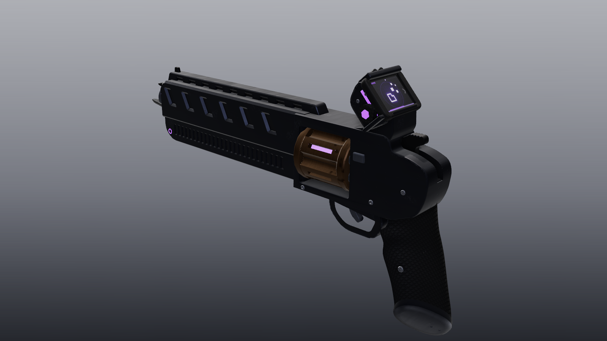

# Tool Gun

A sandbox "tool gun" built on a long, heavy six-shot revolver: you pick a tool on the rear display with your thumb, point,
and pull the trigger. A thin zap beam leaves the pronged emitter at the muzzle and sparks where it hits.

Inspired by two things: the tool gun idea from Garry's Mod (a sci-fi gun with a small screen at the back that shows the
selected tool), and a long sci-fi revolver from a reference picture the requester supplied (a slotted top rib, diagonal
ports in a deep barrel shroud, a vented underlug and a bronze cylinder). This is an original design. It does not reuse the
Garry's Mod mesh or copy the reference gun's details or emblem. There is no text, lettering, number or logo anywhere on
the model or its screen: the display shows only pictograms and abstract UI.

- **Size:** 402 × 228 × 59 mm (length × height × width, including the display, the emitter prongs and the cylinder,
  which stands proud of the frame). The barrel shroud runs from the frame face to the muzzle, 218 mm, about 54 % of the
  overall length.
- **Frame:** squared-off dark graphite alloy. The top strap ends in a rounded corner and steps down to the hammer; behind
  the hammer the backstrap rises in a curve to a hump, and the hammer swings through a slot cut in it. The cylinder
  window has a recoil shield behind it. There is a cylinder latch on the left and hex screws on both sides. A five-lamp
  charge ladder sits in a recess on the right side, above the grip.
- **Barrel:** a deep shroud with six forward-leaning ports showing the black steel barrel. It sits over a slightly
  narrower underlug with a row of 28 vents. The top rib is continuous and has 9 through-slots and a front sight with a
  violet dot.
- **Cylinder:** 53 mm fluted bronze drum, about 80 % of the shroud-plus-underlug height. Six 5.6 mm deep flutes with
  dark floors, six chambers, each holding a glowing energy cell (steel end caps); a window between the flutes shows each
  cell, two per side. It turns one chamber per shot, counter-clockwise as seen from the rear.
- **Tool kit:** a 44 × 33 mm display in a chunky polymer bezel sits in a housing above the hammer. The housing tilts
  42° back toward the shooter's eye and grows out of a sloped fairing as wide as the frame top, with no gap under it. It has a sun hood, a rear sight notch, cooling slits and violet side lamps, and a
  knurled thumb wheel on the left side picks tools. A polymer conduit with clamps runs along the right-hand step from the
  frame to the emitter block. The emitter is a steel crown with three prongs that reach 25 mm past the shroud face, a segmented glow ring and a
  glowing core just behind the ring.
- **Grip:** a one-piece textured wrap lofted through rounded egg-shaped sections, raked 15° back: the backstrap carries
  on from the frame's curve, a 3.5 mm palm swell at mid height, a finger groove under the guard, a slight flare and a
  rounded heel at the butt. Alloy butt cap, hex grip screws, lanyard loop.
- **Finish:** dark graphite alloy, black steel, bronze used sparingly, and small violet (#8a4dff) lights.

## Files

| File | What |
| --- | --- |
| `tool-gun.glb` | The model: named parts, moving nodes, 5 clips, locators, screen atlas (23,756 triangles) |
| `unity/tool-gun.glb` | Game-ready copy (`tools/unity-export.js`): merged per moving part, box UVs, LOD0/1/2 = 23,458 / 14,699 / 9,571 triangles, 5 box colliders |
| `viewer.html` | Interactive viewer |
| `preview.png` | Hero render: rear-high three-quarter from the left, showing the lit display and the cylinder |
| `../../unity/Runtime/ToolGun.cs` | Unity component: tools, firing, beam, events, screen cells, clip playback |
| `INTEGRATION.md` | Unity setup, nodes, clips, atlas |

## Parts

Static, under `tool_gun`: `barrel_shroud`, `underlug`, `shroud_core`, `barrel`, `top_rib`, `top_rib_core`, `front_sight`,
`front_sight_dot`, `frame`, `hammer_slot_floor`, `recoil_shield`, `forcing_cone`, `cylinder_latch`, `frame_screws`,
`ladder_recess`, `charge_ladder`, `grip`, `butt_cap`, `grip_screws`, `lanyard_loop`, `trigger_guard`, `conduit`,
`conduit_clamps`, `conduit_port_rear/_front`, `muzzle_side_lamps`, `screen_mount`.

Moving nodes: `trigger_assembly`, `hammer_assembly`, `cylinder_assembly` (cylinder, bands, `cylinder_flute_floors`, `energy_cells`, `cell_caps`),
`emitter_assembly` › `emitter_ring` and `fx_beam_flash`, `screen_assembly` (housing, bezel, `screen`, `screen_glass`,
lamps, sights, `selector_wheel`, `fx_scanline`).

Locators: `muzzle` (beam origin, +Z forward), `screen_center` (+Z out of the glass), `grip_attach` (hand attach on the
grip axis).

## Clips (30 fps)

| Clip | Length | What moves |
| --- | --- | --- |
| `idle` | 2.0 s loop | scan line sweeps the display, emitter ring turns slowly (the script also pulses the screen glow) |
| `fire` | 0.6 s | trigger pull, hammer rises then drops at 0.11–0.135 s, cylinder turns one chamber, emitter flash peaks at 0.125 s, ring spins |
| `deny` | 0.6 s | dry fire for a shot with no valid target: the same trigger, hammer and cylinder action as `fire`, no emitter flash (the screen shows the error frame) |
| `switch_tool` | 0.45 s | thumb wheel clicks one detent, cylinder ticks, scan line wipes (swap the screen cell at 0.2 s) |
| `inspect` | 2.6 s | display tilts up 22° and back, cylinder spins a full turn, hammer half-cocks, wheel rolls |

## Screen

The screen atlas is 1024 × 768: 4 × 4 cells of 256 × 192 px. Cells: `boot`, `idle` (the tool menu), `select` (the slide
frame), `fire` (the charge burst), `error` (denied), and 11 tool pictograms: remover, weld, rope, balloon, color,
material, hold, thruster, light, wheel, duplicate. The screen mesh's UVs cover one cell, and you pick a cell by moving
the texture offset. The plain glb shows `idle`. The atlas has no mipmaps (sampler LINEAR) so neighbouring cells never
bleed into the shown one at a distance.

## Viewer

Drag to orbit. The viewer has a tool strip with prev and next buttons (Q / E), Fire (F or Space: beam and sparks),
Denied (the `deny` clip: dry fire with the error frame, no muzzle flash), clip buttons, five views (hero, right, left, top, screen), wireframe, orbit and
sound (a small WebAudio synth). It works at phone width. Like the other viewers in this repo, it loads three.js from
cdn.jsdelivr.net. It also requests Google Fonts; offline it falls back to system fonts.
