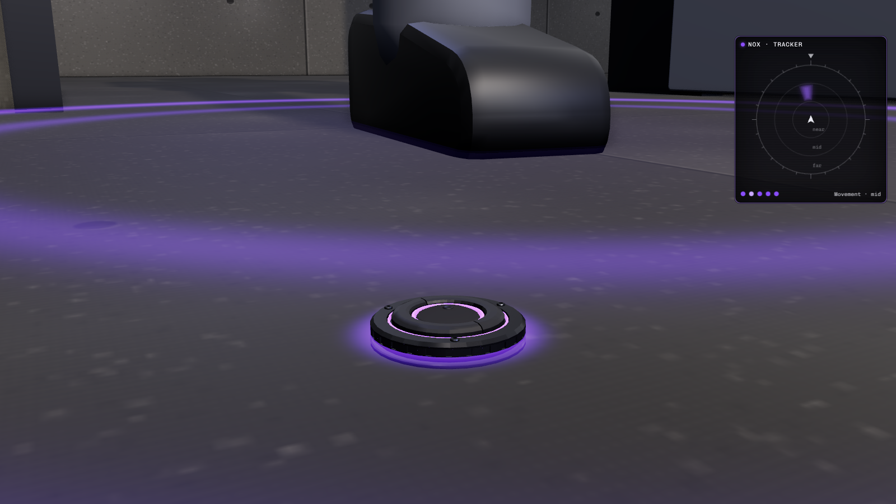

# Tracker Tags

Nox's intel gadget: five coin-sized adhesive tags that stick to walls, doors, floors and hatches and feel
footsteps, vaults and breaches through the surface. Nox's HUD gets a rough direction and a distance band, never
the exact spot. Cheap and passive: many tags, short range (about 3 m for a running step), rough information.
Each tag shows a faint purple ring light that attackers can spot and shoot; shooting one sends Nox a tamper alert.
Dark alloy and composite, purple lights, hex screws, no markings.

The tag is 32 mm across and 8 mm tall stuck (5.8k triangles). The pack is a palm-sized dispenser, 49 × 80 × 55 mm,
holding the five tags in a sprung stack (19.2k triangles).

## Files

| File | Contents |
| --- | --- |
| `tracker-tag.glb` | One tag, stuck, with its clips. Origin at the centre of its back, on the surface; +Y is the surface normal. |
| `tracker-tags-pack.glb` | The pack with five tags (`tag_1` on top, out next). Origin under the middle of the base, +Y up, exit slot +Z. |
| `unity/*.glb` | Game-ready copies (merged meshes, UVs, LODs, colliders). Driven in Unity by `../../unity/Runtime/TrackerTags.cs`. |
| `sounds/` | `eject`, `stick`, `pulse_tick`, `hud_ping`, `tamper`, `tamper_alert`, `breach`, `footstep` (44.1 kHz mono WAV) and `generate_sounds.py` that makes them. |
| `INTEGRATION.md` | How it works in game, how to wire it up in Unity (needs `Nullfield.cs` too), and how to change and rebuild it. |
| `viewer.html` | Interactive viewer (a room with an attacker walking through) and the procedural source. |

## Clips

| File | Clip | Length | What moves | Keys |
| --- | --- | --- | --- | --- |
| tag | `stick` | 0.25 s | Lands or is pressed on: the gel ring squashes, three prongs seat 1 mm into the surface, the ring light rises. At 0 s it is the free pose (in flight, in the pack). | gel, body, prongs, led_ring, membrane |
| tag | `pulse` | 0.35 s | Felt a step: the sensing membrane ticks down and springs back, the pulse ring pops up and sinks. | membrane, pulse_ring |
| tag | `tamper` | 0.5 s | Shot: the cap splits, both halves flip open, the membrane caves in, the ring light sinks, the body shakes. Holds its last pose. | body, led_ring, membrane, cap_a, cap_b |
| pack | `equip` | 0.4 s | The gate slides down to open the exit slot, the thumb slide clicks back. Backwards closes it. | gate, slide |
| pack | `eject` | 0.35 s | The thumb slide pushes `tag_1` 26 mm out of the slot and springs back; `tag_1` stays out. | slide, tag_1 |

LEDs cannot be animated in glTF: the pulse ring (`pulse_purple`) moves instead, and the game turns the lights off
on a dead tag and flashes them on a pulse. Start and end poses of every clip are in `INTEGRATION.md`.

## Viewer

Five tags stick themselves to the open door, the floor inside the doorway, the floor hatch, the side wall and the
floor by the mat. A dummy attacker walks a loop through the door; each step sends a faint ring through the floor,
and tags in range pulse. The panel in the corner is Nox's HUD: fuzzy arcs on a compass ring with near, mid and far
bands. **Crouch / Walk / Sprint** (1, 2, 3) change the attacker's gait, **Breach** (B) sets off a charge on the far
wall (felt out to 6 m), **Shoot** (X) or Shift-click destroys a tag (tamper alert on the HUD), **Re-tag** (R)
refills the pack. Click a surface to stick a tag (with none left, the oldest one moves). Views Room, Tag (each
click shows the next tag) and Pack. The mat is a soft floor (steps on it count 0.4).
