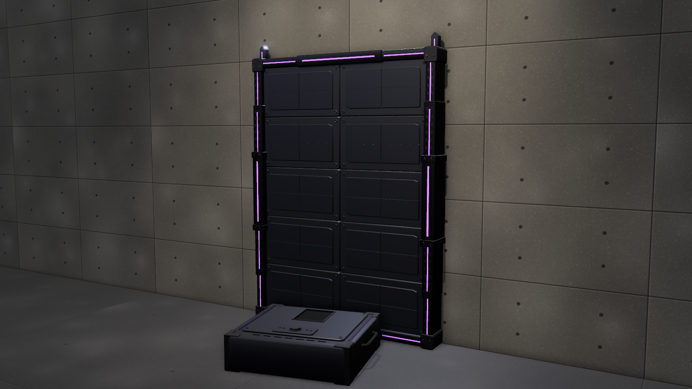

# Wall Fortification

Automated wall reinforcement. The operator places the base unit in the middle of a wall
and traces the arm code on its touch screen. After a press of the confirm button, the unit
expands into a reinforced wall:

1. **Sideways first.** A band of panels slides out from behind the core, centre column first,
   each one coming out from behind its neighbour, so the furthest columns land last. The side rails
   step out of the housing onto the band's outer edges and ride out with them (the beams telescope
   alongside), so the frame reaches the edges together with the last columns.
2. **Then up and down.** The rows slide out of the band, nearest first, and the far corners go on
   last. The top and bottom beams ride on the outermost rows, and the rails telescope with them.
3. **Lock.** The panels seat flush and lock bolts shoot 10 cm up into the ceiling frame and down
   into the floor. Tie rods then punch through the wall, and X-shaped star anchors twist-lock on
   the far side.

4. **Terminal ejects.** 0.3 s after the lock the terminal (the loose control module with the touch
   screen) unlatches, kicks off and drops to the floor, dark. With the only controls gone, the wall
   cannot be deactivated or retracted.

Every part is rigid and slides or turns, except the tie rods: they scale up from nothing as they punch
through the wall. There are no logos, decals or printed text: the only graphic is
the 3 × 3 code pad on the touch screen.

## Files

Sizes differ in width only; every variant covers the full 2.0 m wall height. Nothing reaches past
the unit's width, so several units can sit flush side by side. Place them W apart; the only parts
that pass the outline are the lock bolts, 10 cm above and below.

| File | Width | Panels (rows × columns) | `deploy` clip | Triangles |
| --- | --- | --- | --- | --- |
| `wall-fortification-small.glb` | 1.0 m (doorway / narrow) | 5 × 2 | 2.8 s | ~44k |
| `wall-fortification-standard.glb` | 1.5 m (single wall) | 5 × 2 | 2.8 s | ~44k |
| `wall-fortification-large.glb` | 3.0 m (wide wall) | 5 × 4 | 3.2 s | ~62k |
| `wall-fortification-xl.glb` | 4.0 m (bulkhead) | 5 × 6 | 3.6 s | ~80k |
| `wall-fortification-hatch.glb` | 1.2 × 1.2 m square floor hatch | 3 × 3 | 2.5 s | ~40k |
| `viewer.html` | Interactive viewer and the procedural source of the `.glb` files | | |

Panels share one mesh per file, so the files stay around 2 MB.

## Sounds

`sounds/` holds generated mechanical sounds (44.1 kHz mono WAV), made by `sounds/generate_sounds.py`
(numpy only; run it to regenerate or tweak them).

- **`deploy_<size>.wav`:** start it with the `deploy` clip. It is built from the same timeline as
  the animation: the servo runs while the parts move and stops with them, and each clank lands on the
  frame a column, rail or row hits its stop. The tie rods thump one after another, and the slam lands
  on the lock frame.
- **`eject.wav`:** start it with the `eject` clip: latch kick, screen power-down, and the terminal
  landing 0.62 s in.
- **One-shots:** `place`, `touch_tap`, `arm_confirmed` play before the clip, when the base goes on
  and the operator traces the arm code. `button_press`, `motor_spread`, `rail_extend`,
  `panel_latch`, `lock_bolt`, `anchor_set` and `locked` are separate pieces for custom
  setups.
- **`cues.json`:** lists every animation event's time for each size.

## Using it in a game

- **Units:** metres, +Y up. The unit faces +Z, away from the wall.
- **Origin:** bottom centre of the reinforced area, on the wall surface (z = 0). Put it on the
  defender side of the wall.
- **Rest pose:** fully deployed and locked, terminal still latched.
- **Animation:** `deploy` runs from the stowed base to the locked wall, in this order:
  1. Confirm press.
  2. The sideways spread.
  3. The vertical spread.
  4. Lock.

  Play it after your touch-screen interaction. Then play `eject` (1.0 s, starting 0.3 s after `deploy`
  ends): the `terminal` node drops to the floor in front of the wall (beside the hatch on the hatch).
  There is no retract; never play `deploy` backwards. You can also detach `terminal` and hand it to
  physics instead.
- **Far side:** the star anchors and tie rods sit under the `far_side` node, set for a 0.3 m wall.
  Set that node's z to minus your wall's thickness.
- **Hatch:** a perfect square laid face-up. The origin is the centre of the square, on the floor
  surface, and the unit faces +Y. Everything sits under `hatch_mount`, and its lock bolts drive down
  into the floor. The star anchors are on the underside, 0.3 m down; move `far_side` for other floor
  thicknesses.
- **Nodes:**
  - `terminal` (the ejectable control module, with `confirm_button`; its LEDs use `led_terminal`)
  - `rail_left` / `rail_right` (sleeves, `*_upper_n` / `*_lower_n` stages, clamps and `*_lockbolt_top` / `*_lockbolt_bottom`)
  - `post_centre` (large and XL only)
  - `beam_top`, `beam_bottom` (with `*_left_n` / `*_right_n` stages)
  - `panel_rR_cC`
  - `far_side` (`tie_rod_n`, `star_n`)
- **Materials:** PBR, with emissive purple LEDs and the screen. The screen texture is the code pad
  with the accepted code (the locked state). Every bolt has a hex socket recess.

## Viewer

Open `viewer.html`. **Deploy** (D or Space) plays the whole sequence, ending with the terminal
ejecting. While placing or arming the button cancels; once the wall is going up it cannot be stopped,
and once sealed the button reads **Reset** and starts over with a fresh unit. There are size buttons (1–5), views including **Far side**, part labels and a slow orbit.
