# Haneul Tower

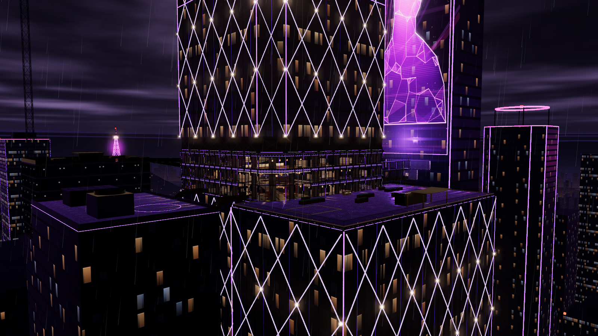

A Siege-style 5v5 attack/defend map: three consecutive upper floors (96F to 98F) of **Haneul Tower** (*haneul* means
*sky*), a fictional mixed-use supertall on the north bank of the river in Seoul, in 2111. It is a rainy night
just before midnight, 403 m above the water. The tower continues about 30 floors above the map to a lattice
crown. Below the map there is only the drop to the wet streets, the lit bridges and the light trails, with dark
mountain ridges round the city and a lattice broadcast tower on a forested hill.

Every building, brand and company is fictional, and no real landmark is reproduced. There are no logos and no
readable text in any geometry or texture: screens and holograms show abstract graphics only, and callout names
live in the UI overlay and the floor plans.

Inside, contemporary Korean design meets 2111 tech under purple neon: warm wood lattice screens, glowing
paper-like hanji panels, stone and warm ondol floors, a pavilion with sweeping eaves in the sky garden, and
indigo, cinnabar and ochre accents.

**Open `viewer.html`** in a browser. The page is ready in about 30–40 s on a software renderer and much
faster on a GPU. It offers:

- orbit, plus walk and fly modes (V; WASD, Shift to sprint, F to fly);
- floor isolation (keys 0–3);
- an X-ray overlay coloured by surface type (X), with callout labels (L) and markers (M);
- toggles for rain and the skyline;
- camera presets for every site and attacker spawn;
- the planned furniture footprints (P or M: they show with the markers and are off by default).

## Floors

| Map floor | Level | Floor y | Programme | Signature spaces | Sites |
| --- | --- | --- | --- | --- | --- |
| F1 | 96F Garden Level | 0.0 m | sky garden, spa, sky-hotel kitchen and back of house | **Garden** (double height, with a pavilion, a reflecting pool and the Garden Stair), **Sky Terrace** outside | S4 |
| F2 | 97F Sky Lobby | 4.2 m | hotel sky lobby, skybridge arrival, broadcast studio, lounge bar | **Gallery** over the garden, **Studio** (double height, with the holo stage), **Skybridge** | S2, S3 |
| F3 | 98F Broadcast | 8.4 m | control room, render farm, newsroom, executive suite, screening room | **Grid** catwalks A/B/C over the stage, **Control Room** director window | S1 |

The floor plate is a 52 × 52 m chamfered square around an indestructible 18 × 18 m concrete core. Floor to
floor is 4.2 m (3.1 m ceilings). Two diagonal double-height voids, the Garden (SW, F1–F2) and the Studio
(NE, F2–F3), give vertical sightlines. The F3 ceiling is the underside of the 99F mechanical floor, which is
hard and never opened.

| | | |
| --- | --- | --- |
| 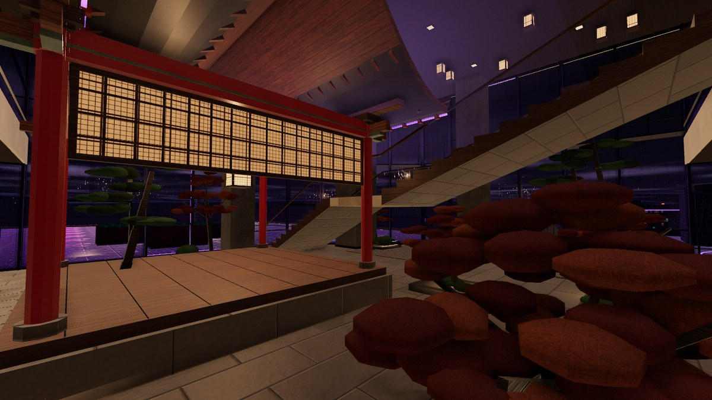 | 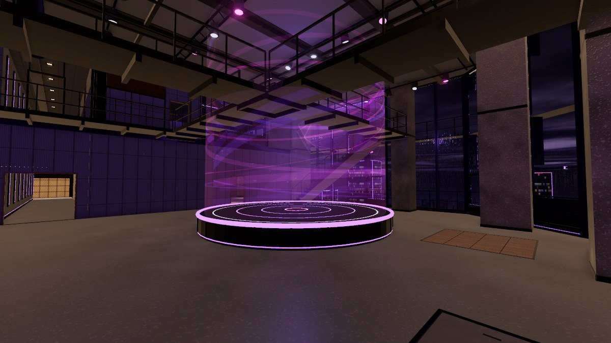 | 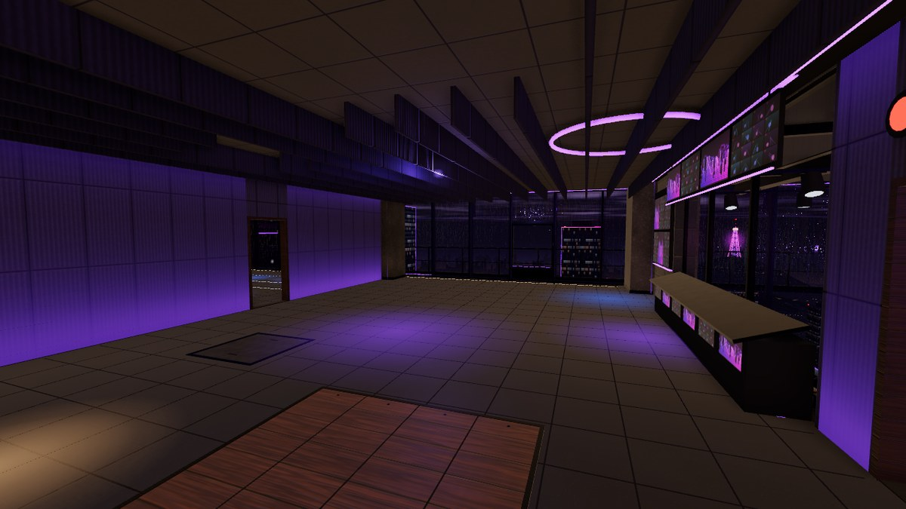 |
| Garden (F1) | Studio and holo stage (F2) | Control Room, S1 (F3) |
| 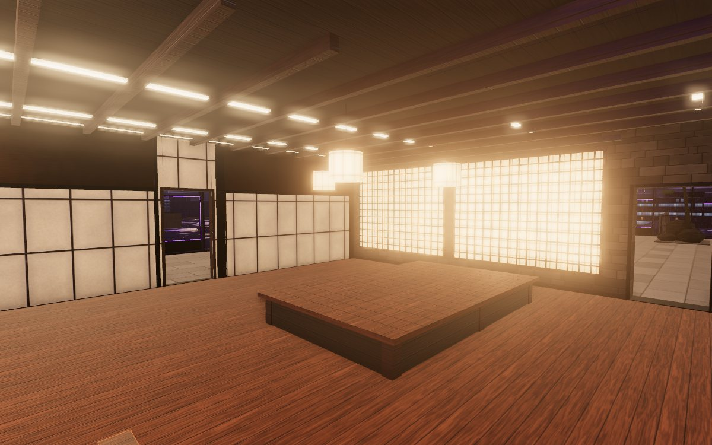 | 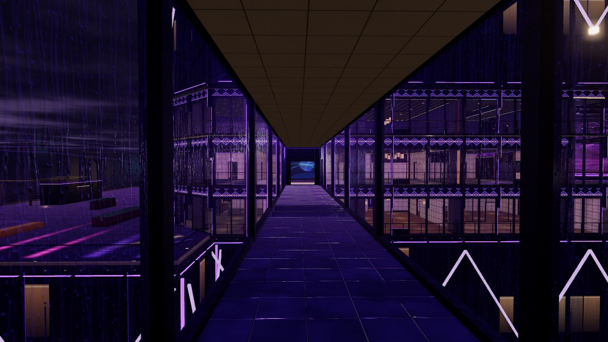 | 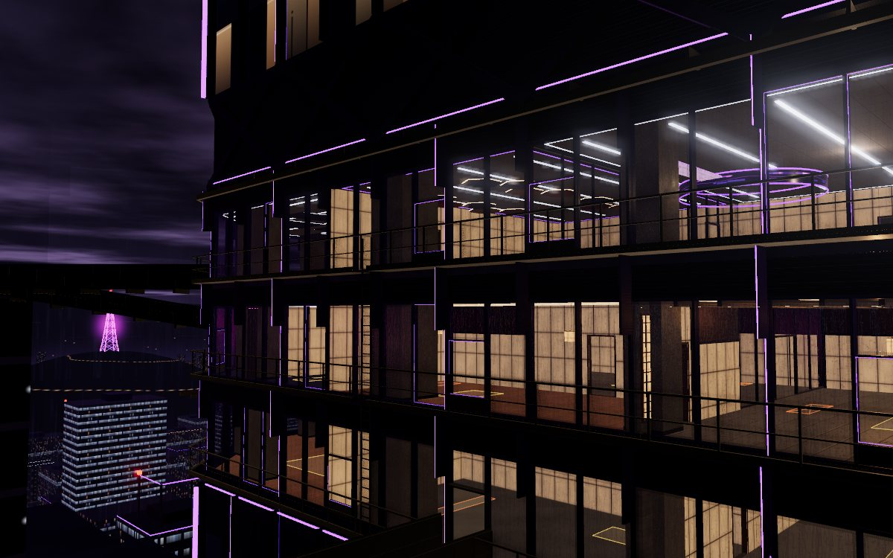 |
| Tea Room, S4 (F1) | Skybridge, A3 (F2) | West facade, ledges and rappel |

## Sites

Each site is two adjacent rooms with one objective in each and a defender spawn (five points) inside.

| Site | Floor | Rooms | Defender spawn | Reinforce candidates | Hatches |
| --- | --- | --- | --- | --- | --- |
| **S1** | F3 | Control Room / Render Farm | D1 | 10 | H14, H15 (in the site floor, from above) |
| **S2** | F2 | Concierge / Deposit | D2 | 10 | H07, H08 (ceiling, reinforced from the floor above) |
| **S3** | F2 | Lounge Bar / Wine Room | D3 | 10 | H09, H10 (ceiling, reinforced from the floor above) |
| **S4** | F1 | Tea Room / Ondol Lounge | D4 | 12 | H01, H02 (ceiling, reinforced from the floor above) |

Defenders get **8 reinforcements per round**. A wall unit of any size counts 1, and so does a hatch. Every site
offers more candidates than that, so defenders have to choose.

## Attacker spawns (all outside)

| Spawn | Where | Landing 1 | Landing 2 |
| --- | --- | --- | --- |
| **A1 Sky Terrace** | the wet setback terrace on the river side (F1 level), behind a lift kiosk under a timber canopy | Garden Doors / Bath Door, 7.7–7.8 s | Veranda windows, 8.6 s; SE/SW ladders to the F2/F3 ledges |
| **A2 West Roof** | the roof of the lower west neighbour (y −1.5), in the lee of its plant room | Catwalk door, 9.7 s | South Catwalk to the Garden entry window, 12.7 s; West Ladder to the ledges |
| **A3 Skybridge** | the East Tower's bridge hall (F2 level), behind a hard baffle | glass skybridge to the portal, 8.8 s | service stair, then the Bridge Truss under the bridge to the Bathhouse window, 11.6 s |
| **A4 Crane Deck** | the open top floor of a tower under construction (F3 level), inside a site hut | Gantry to the NW gantry door, 7.3 s | Hoist Ramp down to the Noraebang window on the F2 ledge, 12.5 s |

First entries take 7.2–9.5 s, home sites 11–16 s, and every site is within 28.4 s. Exterior routes:

- an 0.8 m ledge outside the glass on every floor;
- rappel anywhere on the facade from y 0 to 12.2 (the BMU rail on the 99F band);
- a moving window-cleaning cradle between the F2 and F3 ledges (8 s);
- breakable facade glass and barricadable entry windows.

The terrace, ledges, bridges and neighbour roofs are defender reveal zones (`ZONE_EXT_`). A spawn-peek check
finds no attacker spawn point visible from any shootable opening.

## Surface types (where the destructible walls are)

The floor plans below show every surface by type. In the viewer, press X for the same colours in 3D.

| Type | Meaning | Count (layout) |
| --- | --- | --- |
| **hard** | indestructible: concrete core, shear and stone walls, columns and column wraps, slabs, exterior structure, and every wall corner and T-junction (1.0 m along each arm) | 139 wall segments, 778.1 m (33 core, 30 column wraps, 65 former partitions made hard by the junction rule), plus the hard ends, jambs, trims and headers of the reinforceable walls |
| **breakable + reinforceable** | the only destructible wall type: Wall Fortification-sized panels (0–2.0 m high) in the straight runs between hard ends, with hard trims and a hard header above | 72 walls with 169 units, 337.5 m of panel: XL ×22, large ×38, standard ×53, small ×56 |
| **hatch** | 1.2 × 1.2 m breakable floor panel; takes the gadget's hatch unit | 15 (all reinforced from above, face-up, as in Siege) |
| **soft floor** | 2.4 m destructible floor/ceiling patch for vertical play | 9 |
| **barricadable door / window** | openings that take a barricade | 121 interior doors, 4 interior windows, 39 facade entry windows, 4 facade doors + 2 facade double doors (127 `BARR_D_`, 43 `BARR_W_`) |
| **open** | archway, counter or pried lift door: never barricaded | 7 in the building + 4 exterior (skybridge north/south ends, bridge ladder, NB east truss): 11 `OPEN_` slots |
| **glass, interior** | breakable | 12 walls |
| **facade glass** | breakable (entry or sightline) or tempered (unbreakable) | 44 breakable, 255 tempered lites |
| **glass floor** | walkable tempered panel in the skybridge | 1 |
| **rail** | glass balustrades and rails: shoot and vault over | 2 balustrades plus every ledge, catwalk and stair rail |
| **hologram** | the stage hologram blocks vision, not bullets; its emitter is destructible and switched from a Control Room console | 1 |

> **User rules applied: hard corners, fewer breakable walls, every breakable wall reinforceable.** At every wall
> corner and T-junction (and where a wall meets the facade) each wall arm is hard for at least 1.0 m. Breakable
> panels exist only in the straight run between hard ends and door/window jambs (0.15 m); a run under 2.4 m is
> hard. Every breakable wall is reinforceable: there are no soft walls left. Before: 140 breakable walls (112 soft,
> 28 reinforceable), 679 m. After: 72 walls, 337.5 m of panel (-49 % of the walls, -50 % of the length, and the
> panels stop at 2.0 m, so the breakable area is roughly a quarter of what it was). Soft floor patches stay breakable
> but not reinforceable; hatches stay reinforceable.

There are also 19 deployable-cover spots and 8 objective markers. Wall Fortification sizes are XL 4.0, large 3.0,
standard 1.5 and small 1.0 m wide, all 2.0 m high, and the hatch unit is 1.2 m
(`gadgets/wall-fortification`). Every unit sits on the clear defender face with at least 5 cm of hard trim at
each end.

**How to read them in the world.** Every hard surface (core, shear walls, column wraps) is clad in one family:
dark honed granite panels with deep reveals and a metal base. Breakable panels are thin and
change with the programme: backlit hanji on a regular timber lattice in three patterns (fine square sal in the
hotel rooms, tti-sal with even bands in the spa, lozenge bit-sal in the bar wing), fluted acoustic fabric washed by
wall grazers on the media floor, painted gypsum in back of house. Hatches are brushed-steel plates in a raised angle
frame with two lift slots, with a lit framed hanji tile on the ceiling below; soft floor patches are screwed timber
boards in a steel angle, with a dark framed board below. Entry windows have a heavy dark sash frame, a tinted lite and
a rappel anchor plate under the sill outside. Each breakable panel has visible unit seams; around it the hard
ends, jambs and trims are dark steel, with a steel transom at 2.0 m and a bronze bulkhead above, so the hard
junction ends read as hard in the normal view; former partitions that are now fully hard are clad like the core. All walls rise to the slab above (3.9 m), so nothing shoots through the plenum over
the 3.1 m ceilings; interior glass has a hard bulkhead over its head.

## Floor plans

Each plan shows walls by surface type, doors and windows, hatches, soft patches, stairs, ladders, ledges and
rappel lines, callouts, sites, objectives, spawns and cover, with a legend. They are rendered straight from
`layout.json` by `tools/render_plans.py`.

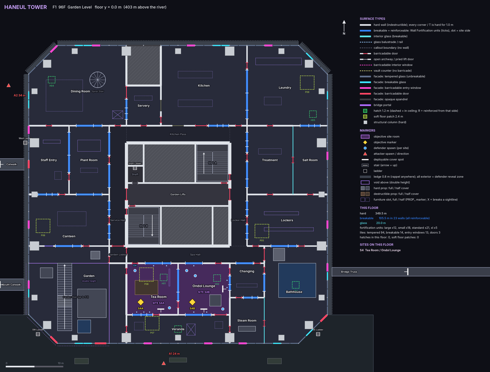
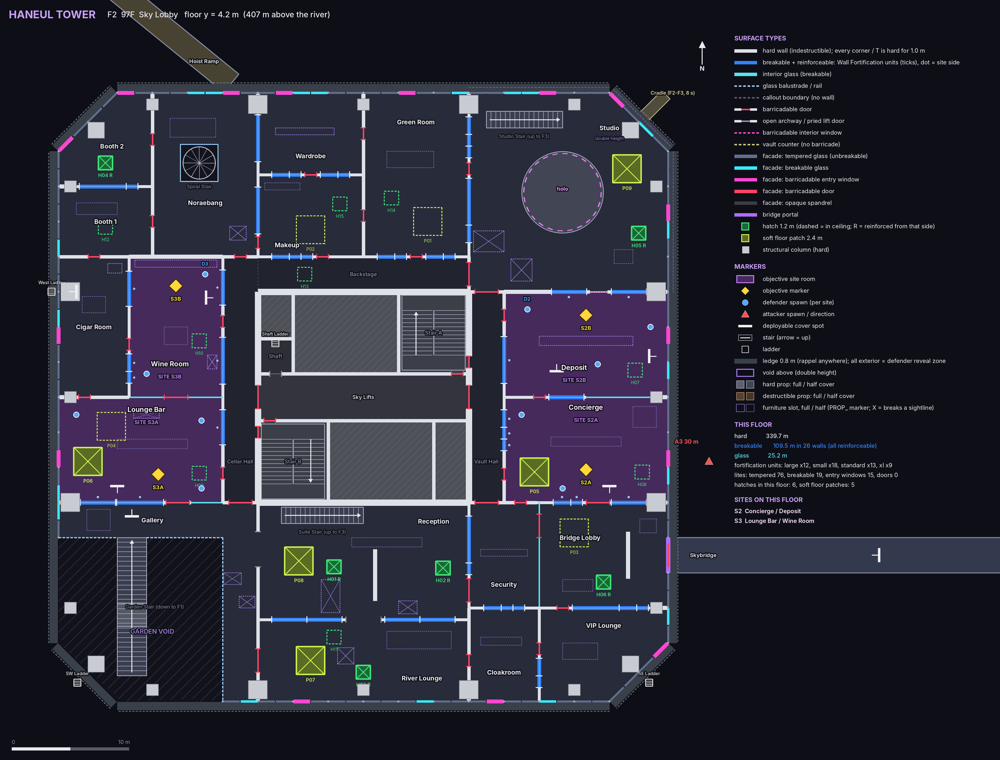
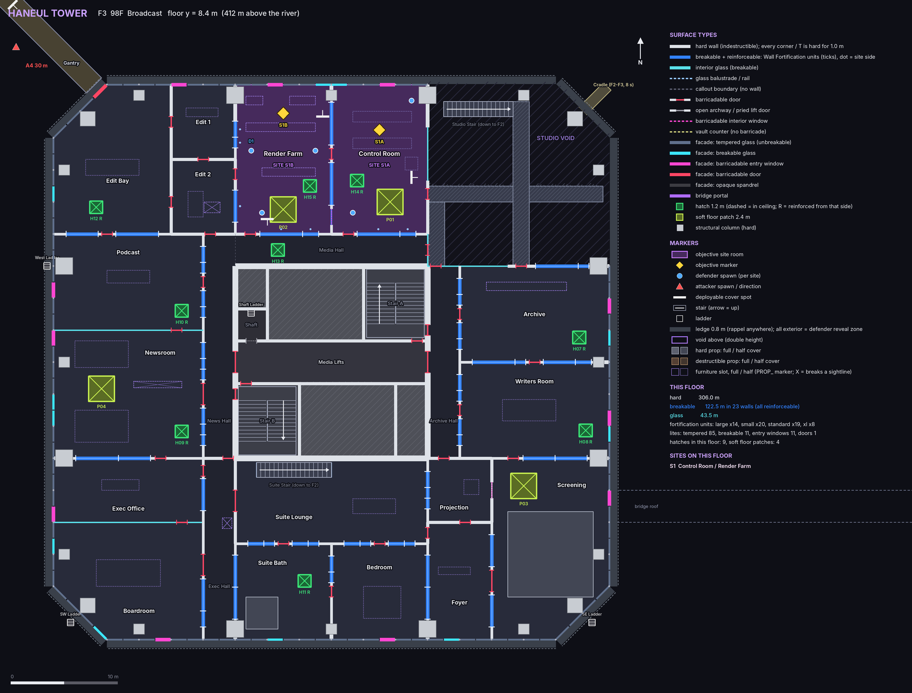
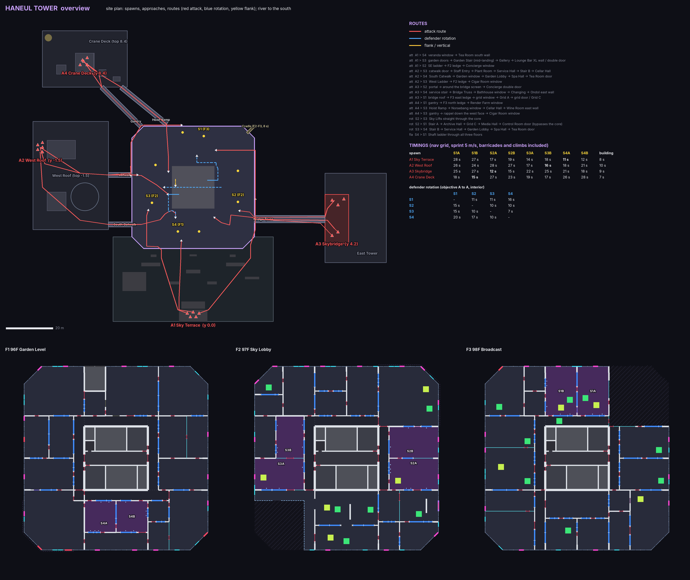

## Furniture

The map ships without furniture. Each layout prop is an empty `PROP_<id>` marker with its box, height, cover
class and whether it breaks a sightline. The breakable furniture in `props/haneul-furniture/` is made to fill
these markers. Twelve props are part of the building and are in the map itself: the pavilion, the reflecting
pool, the garden rocks and pine, the dry-stone screen, the maru platform, the ondol bench, the hot pool, the
steam bench, the shower block, the holo stage, the screening tiers and the stone bath.

## Files

| File | What it is |
| --- | --- |
| `viewer.html` | interactive viewer and the procedural source the `.glb` files are exported from |
| `haneul-tower.glb` | the map: 467k triangles, 38.3 MB, 1,997 nodes, one node per typed surface with extras; the whole city skyline backdrop is one node, `BACKDROP_city` (one mesh, one baked material, one draw call; 132k triangles) |
| `unity/haneul-tower.glb` | the Unity copy: the same 1,997 nodes (38.3 MB); the backdrop is the same single `BACKDROP_city` node (no culling tiles) |
| `layout.json` | the layout: the single source of truth for floors, rooms, walls, openings, hatches, sites, spawns and routes |
| `floorplans/` | one plan per floor plus an overview, each with a legend |
| `shots/` | viewer screenshots |
| `DESIGN.md` | the level design: concept, callouts, sites, spawns, timings, sightlines, construction rules |
| `INTEGRATION.md` | naming scheme, extras, layout schema, gadget sizes, Unity setup, how to rebuild |
| `src/` | engine (`core.js`), part files, viewer template, helpers |
| `tools/` | `build_layout.py` (the layout generator), `validate_layout.py`, `render_plans.py`, `navtime.py`, `build_viewer.py` and the checks they use |

Unity scripts are in `unity/Runtime/HaneulTowerMap.cs` and `HaneulSurface.cs` at the repo root, with the editor
helper in `unity/Editor/HaneulTowerMapSetup.cs`. See [INTEGRATION.md](INTEGRATION.md).
