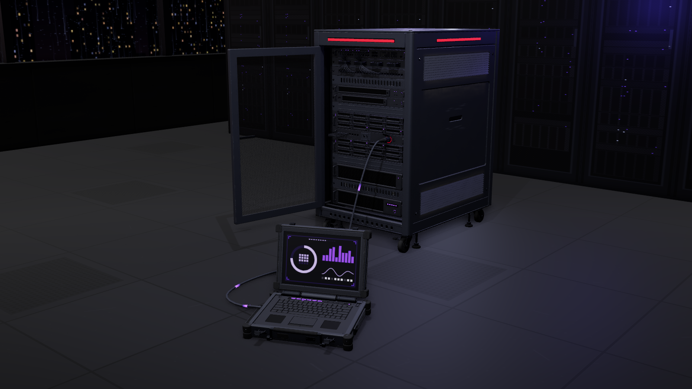

# Uplink

The objective of a round. Instead of planting a bomb, the attackers steal data from a server.

- **Uplink Server** (`uplink-server.glb`, the "bomb"). An ordinary half-height 19-inch rack cabinet (18U) on
  casters, with two per site. Behind its perforated front door it holds a switch with patch cables, a patch
  panel, two 1U compute servers, two 2U storage servers with 24 hot-swap drives, an I/O panel and a UPS.
  Defenders protect it.
- **Uplink Laptop** (`uplink-laptop.glb`, the "defuser"). A bulky rugged field laptop the attackers carry.
  An attacker crouches and plants it on the floor in front of a server. It opens, and its armoured data
  cable is carried to the server's front data port and locked in. Then it pulls the server's data down the
  cable. Defenders win by disabling the laptop before the upload finishes. Attackers win when it completes.

There are no antennas and nothing wireless: the link is the cable. Both models are dark powder-coated steel
and composite with purple `#8a4dff` LEDs and hex-socket screws. They carry no text or markings, and the
laptop's screen art is abstract.

| | Size (m, W × H × D) | Triangles (LOD0) | Origin |
| --- | --- | --- | --- |
| Server | 0.60 × 1.05 × 0.80 (0.81 deep with the door handle) | 131k (LODs 65k / 24k) | floor, middle of the footprint |
| Laptop | 0.40 × 0.085 × 0.30 closed, about 7 kg | 54k (LODs 38k / 18k) | floor, middle of the closed laptop |

Both models are +Y up with the front facing +Z: the server's door, and the laptop's handle edge where the
operator kneels. The laptop's cable bay is on its -X side.

## Files

| File | Contents |
| --- | --- |
| `uplink-server.glb` | The server, closed and idle, with its 5 clips. |
| `uplink-laptop.glb` | The laptop at rest, deployed (lid open, plug popped out of its bay), with its 7 clips and the screen atlas. |
| `unity/uplink-server.glb`, `unity/uplink-laptop.glb` | Game-ready copies with merged meshes, UVs, LODs and box colliders. Unity scripts: `../../unity/Runtime/UplinkServer.cs` and `UplinkLaptop.cs`. |
| `sounds/` | 21 sounds (44.1 kHz mono WAV) and `generate_sounds.py`, which makes them. Its docstring says when each one plays. |
| `INTEGRATION.md` | Rigs, clips, the screen atlas, the plug and cable contract, the rules, how to wire it up in Unity, and how to rebuild. |
| `viewer.html` | An interactive demo (a server room at night, with a plant played out by a mannequin) and the procedural source of both .glb files. |

## Server clips

| Clip | Length | What happens |
| --- | --- | --- |
| `idle` | 4.0 s loop | The two top fans turn 3 times. The drive and link LEDs stay lit and blink off now and then. |
| `link` | 1.2 s | The handle unlatches, the door swings open 100°, and the port's dust shutter flips up. |
| `upload` | 2.0 s loop | The fans spin four times as fast (3 rev/s). A band of 6 lit drive LEDs runs `drive_1` → `drive_24` twice, and the link LEDs flicker. |
| `complete` | 1.2 s | From `upload`: every drive LED goes out, then they relight in one last sweep. The fans slow and the port lock clicks to released. |
| `abort` | 1.0 s | From the end of `link`: the lock kicks, the shutter snaps shut, the door swings shut and relatches. |

`idle` and `upload` key only the fans and LEDs. `link` and `abort` key only the door, handle, shutter and
lock. `complete` keys both sets.

## Laptop clips

| Clip | Length | What happens |
| --- | --- | --- |
| `carry` | 2.0 s loop | Closed and latched, with the handle out. It sways gently about the grip. |
| `deploy` | 2.4 s | It is set down. The handle folds and the latches pop. The lid opens to 105°, the feet kick out, the cable bay door drops open, and the plug pops out of its holster. |
| `link` | 1.6 s | The reel pays out 3 turns while the game carries the plug to the port. The plug collar twist-locks at 1.35–1.55 s. |
| `upload` | 2.0 s loop | The rear fan spins and an activity light shuttles to and fro. |
| `complete` | 1.2 s | The shuttle parks, a small flag lever springs up with a clunk, and the fan spins down. |
| `disable` | 1.2 s | Knocked. The lid is slammed part shut (to -45°), the collar unlocks (the game yanks the plug), and the reel jerks. Sparks come from `fx_sparks` (game effect). |
| `pack` | 1.8 s | The reverse of `deploy`. It reels in and the plug goes back in its holster, then it closes, latches and swings the handle out. It ends exactly on `carry`. |

Only `carry`, `deploy` and `pack` key the plug. While it is out of the bay, the game places it and draws the
cable at runtime between `cable_anchor` (the bay mouth) and the plug, a heavy armoured cable that bows out of
the bay over its dropped door, hangs off the plug and lies on the floor (see INTEGRATION.md).

## Game rules

| Rule | Value |
| --- | --- |
| Plant | The attacker crouches and holds interact for **6 s**. Letting go cancels: the plug is reeled back and the laptop packs up. |
| Plant timeline | 0–2.4 s `deploy`. 2.4 s laptop `link` and server `link`. The plug is in the port by 3.75 s and locked by 3.95 s. 4.0–6.0 s handshake. At 6.0 s the upload starts. |
| Where | On the floor (ground normal y ≥ 0.9), within **3 m** horizontally of the server's port (cable reach), at most 0.5 m above or below it, and at least 0.2 m in front of the server. |
| Upload | **45 s**, from the server to the laptop. |
| Disable | A defender within 1.5 m of the laptop holds interact for **6 s**. Letting go resets the hold, and the upload keeps running meanwhile. Destroying the laptop disables it at once. |
| On disable | The plug is yanked out and drops to the floor. The server plays `abort` and goes back to `idle`. The laptop is dead. |
| On complete | Attackers win. |
| Limits | One laptop per server. A server with a laptop (planted or being planted) refuses another. |
| Progress shows on | The laptop's 10 segments and screen, the server's racing drive LEDs, and purple pulses running down the cable. |
| Defenders' tells | The server's status strip turns alarm red, pulsing at 1.5 Hz. The door stands open with a cable in the port. An alarm chirps every 1.5 s, the upload hum plays and progress ticks sound. |

## Viewer

The page opens on a server in a dark server room high in a tower, with a mannequin holding the laptop.

- **Hold plant** (E): plays the whole plant. Let go early to see it cancel.
- **Hold disable** (F): available during the upload.
- **×5** (X): fast-forwards the upload.
- **Pick up** (P): available after the upload completes.
- **Reset** (R): starts again.
- **Views:** Site, Server and Laptop.
- **Orbit** and **Sound** toggles.
- **Clips:** opens buttons that play any single clip on either model.

The HUD is a ring with no text inside it: the upload ring, the hold ring and ten ticks.
