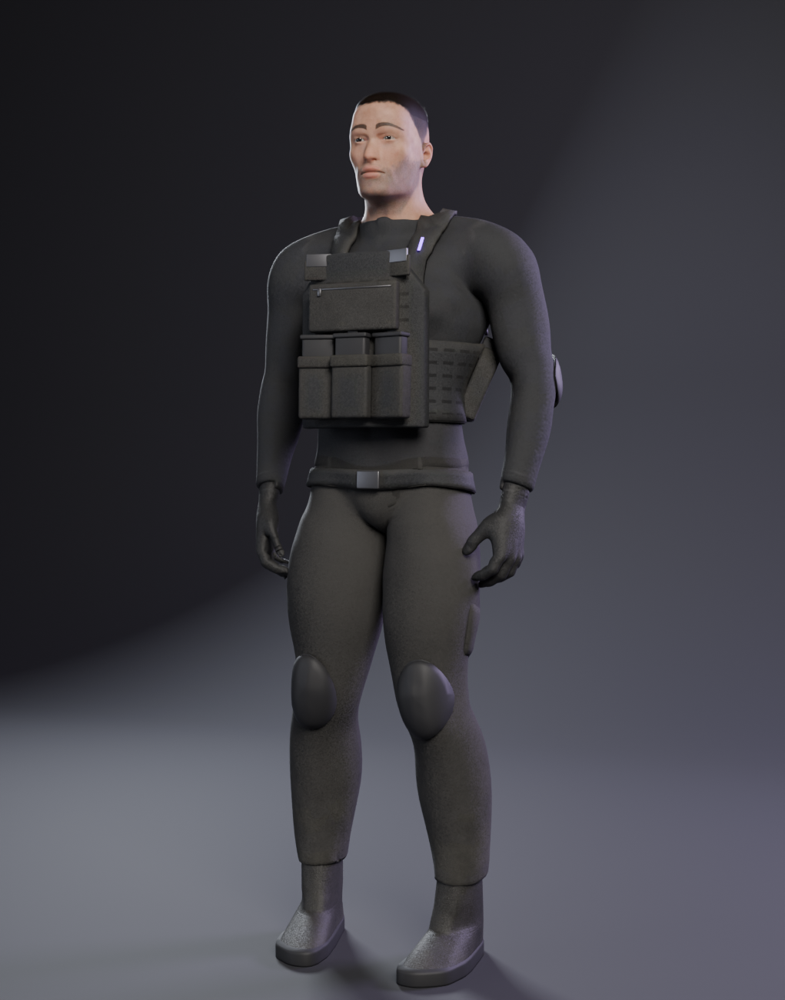

# Human operator prototype

A prototype of a realistic, game-ready human operator: an athletic man of about 30, 1.79 m tall, with short dark hair
in a cropped skin fade and light-to-medium skin. He wears a dark grey crew-neck combat shirt with elbow pads, combat
trousers with knee pads and cargo pockets, gloves and boots, under a near-black plate carrier: front and back plate
covers with laser-cut MOLLE, a cummerbund, shoulder straps, a belt and a few fabric pouches. One thin purple
(`#8a4dff`) status strip on the chest is the only light. There is no text, logo, number, flag or patch anywhere.

The quality target is a current tactical shooter operator in game terms, not a photo-real scan. It is a prototype:
the body, face, skin and kit read well at gameplay and mid range, but close up it still falls short of a AAA scan
(see Known weaknesses).

**Base and licence.** The body mesh, the morph targets that shape him and the skeleton come from MakeHuman 1.x
(base mesh, targets and rigs are CC0, public domain). Everything else (shape settings, skin, eye and hair textures,
brows and lashes, clothing, armour, textures, animation) was made procedurally for this repo. The asset is free to
use, modify and ship in a game with no attribution required.

**Numbers.**

| | LOD0 | LOD1 | LOD2 |
| --- | --- | --- | --- |
| Triangles | 68,450 | 27,635 | 11,733 |
| Draw calls (material slots) | 18 | 14 | 12 |
| Strand brows and lashes | yes | no (painted brows in the skin) | no |
| Hair shells | 5 | 3 | 2 |

Rig: MakeHuman default skeleton, 163 bones, at most 4 weights per vertex, bones named for Unity Humanoid auto-mapping
(Hips, Spine, Chest, UpperChest, Neck, Head, LeftUpperArm, LeftIndexProximal, ...). Rest pose: MakeHuman's A-pose.

Clips (30 fps, all loop, in place): `Idle` (4 s, breathing, slow weight shift), `Ready` (3 s, low-ready rifle hold
with no rifle, bladed stance), `Walk` (1.1 s, 0.94 m/s), `CrouchIdle` (4 s), `LookAround` (6 s, scans left and right
with the eyes leading the head, rifle hold).

## Files

| File | Contents |
| --- | --- |
| `human-proto.glb` | LOD0 only, skinned, all 5 clips, 2K/1K JPEG textures (hair PNG) embedded. 10.8 MB. Origin on the ground between his feet, faces +Z, up +Y. |
| `unity/human-proto.glb` | The game copy: LOD0, LOD1 and LOD2 as separate skinned meshes named `*_LOD0`, `*_LOD1`, `*_LOD2` on one skeleton, all clips, same textures. 12.9 MB. |
| `viewer.html` | Standalone three.js r0.180.0 viewer with the meshopt-compressed GLB embedded (works offline; 12.4 MB): orbit, clip buttons, Studio / Overcast / Night lighting, LOD auto/0/1/2, wireframe, Face / Armour / Back views. |
| `textures/` | Every texture as embedded: `skin_basecolor/normal/orm` (2048, ORM = AO, roughness, metal), `hair_rgba.png` (2048, alpha-tested shells), `eye_basecolor` (1024), `clothing_*`, `cordura_*` (2048), `boots_*` (1024). ORM packing: R = AO (skin) or 1, G = roughness, B = metallic. Normal maps are OpenGL (+Y). |
| `preview.png` | Cycles hero render (Idle pose). |
| `INTEGRATION.md` | Rebuilding from scripts, changing the face and body, swapping gear, the rig and bone map, clips, Unity setup. |

Unity: `../../unity/Runtime/HumanOperatorProto.cs` (LODGroup, material fixes, clip playback) and
`../../unity/Editor/HumanOperatorProtoAvatar.cs` (Humanoid Avatar with an enforced T-pose, for retargeting).

## Known weaknesses

- **Skin** is slightly smooth and waxy at portrait distance; pores only show at grazing light and the lips look a
  little plastic. glTF has no subsurface scattering, so realtime skin is flatter than the Cycles renders.
- **Hands in the Ready / LookAround / Crouch clips** hold an invisible rifle, so without a weapon the arms read as
  crossed. Attach a rifle to the right hand (see INTEGRATION.md) and they make sense.
- **Hair** is five alpha-tested shells over the scalp: fine at game distance, a faint line shows where the shells
  start in the fade. Brows and lashes are thin strands that alias at range (they are dropped from LOD1 on).
- **Mouth** interior and teeth are the crude MakeHuman helpers: keep the mouth closed. No facial blend shapes.
- **Gear**: boots are plain (no laces or tread), gloves have no knuckle or palm detail, pouches are simple boxes and
  the polymer parts are untextured. Fabric folds are procedural, so the trousers and sleeves look tight.
- **Deformation** was checked in Cycles at every clip's key frames; there is a little shirt-under-carrier
  intersection in the extreme LookAround frames (hidden by the carrier) and nothing is cloth-simulated.
- **Cornea** is a clear alpha shell in the realtime files (no transmission), so the eyes have less depth than in Cycles.
