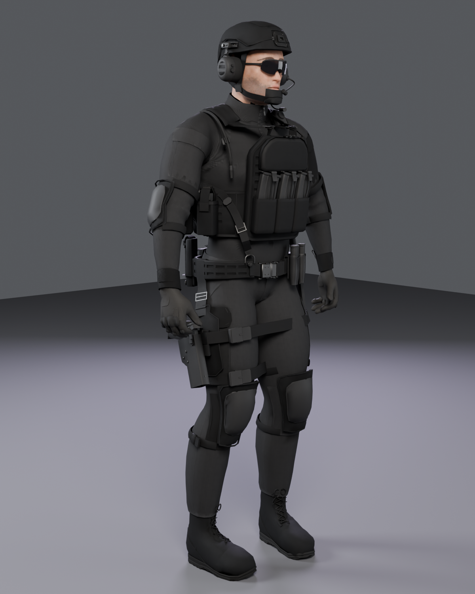
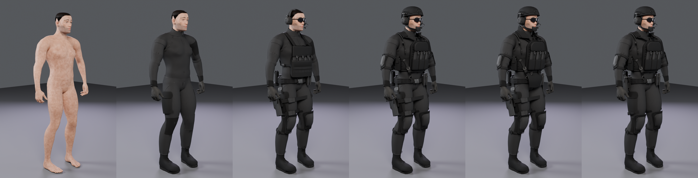

# Human operator rig (modular)

A game-ready, **modular** tactical operator: the human-proto body (MakeHuman CC0 mesh, 163-bone Unity-Humanoid-named
skeleton, skin / hair / eye textures) on one skeleton, wearing 24 swappable gear modules that toggle independently:
combat shirt and trousers, boots, gloves, knee and elbow pads, a plate carrier or a chest rig, a helmet (covered or bare),
neck and groin protection, a battle belt, rifle and pistol magazines, dump pouch, IFAK and tourniquet, radio with PTT,
admin and hydration, a drop-leg or belt holster with a generic pistol, a sling, an active headset and glasses or goggles,
flashbang pouches and a knife or multitool. Near-black fabrics and dark alloy; the only colour is one 4 × 20 mm
`#8a4dff` status strip on the left shoulder strap. There is no text, logo, number, flag or patch anywhere.

*Left to right: Body, Base, Light (chest rig), Assault (default), Full (+ neck and groin), Assault with the belt holster.*

**Numbers** (Blender triangle counts of the visible nodes; three.js reports about 4 % more for the same set).

| Loadout | LOD0 | LOD1 | LOD2 | Draw calls (material slots) LOD0 / 1 / 2 |
| --- | --- | --- | --- | --- |
| Body (no gear) | 40,736 | 15,836 | 6,808 | 22 / 14 / 11 |
| Base (shirt, trousers, boots, gloves) | 48,829 | 18,790 | 8,146 | 33 / 27 / 24 |
| Light (chest rig, belt kit, headset, glasses) | 76,355 | 31,718 | 14,025 | 80 / 74 / 68 |
| **Assault** (default) | **100,724** | **42,778** | **18,648** | 126 / 122 / 109 |
| Full (Assault + neck and groin) | 103,152 | 43,916 | 19,180 | 131 / 127 / 114 |

Every module shares one set of 13 tiling PBR materials (1K, the webbing trim sheet 2K) plus the body's skin, hair and
eye materials, so the draw calls batch well with the SRP Batcher, but they are not merged: see Known weaknesses.

Clips (30 fps, in place, all loop): `Idle` 4 s, `Ready` 3 s (low ready, invisible rifle), `Walk` 1.1 s (0.94 m/s),
`CrouchIdle` 4 s, `LookAround` 6 s, **`Holster`** 4.2 s (draw the pistol from the drop-leg holster, present it two-handed,
reholster), **`HolsterBelt`** 4.2 s (the same from the belt holster) and **`Reload`** 3.6 s (retention reload: the
support hand pulls the left magazine from the front pouch, seats it in the rifle's magwell, strips it and stows it
again). The pistols and that magazine ride on three prop bones (`PropPistolDrop`, `PropPistolBelt`, `PropMag`) that
follow the holster / pouch in every other clip.

## Files

| File | Contents |
| --- | --- |
| `human-rig.glb` | LOD0: every module / part / variant a separate named skinned node on one skeleton (`carrier`, `carrier-led`, `helmet-cover`, `holster_drop-pistol`, `Body__shirt`, ...), all 8 clips, the 4 sockets, node `extras` with the toggle rules, JPEG/PNG textures embedded (2K max). 30 MB. Origin on the ground between his feet, faces +Z, +Y up. Khronos validator: 0 errors, 0 warnings. |
| `unity/human-rig.glb` | The game copy: LOD0, LOD1, LOD2 of every node (`*_LOD0/1/2`) on one skeleton, clips, sockets, textures. 38 MB. Validator: 0 errors, 0 warnings. |
| `viewer.html` | Standalone three.js r0.180.0 viewer with the meshopt-packed GLB (LOD0-2, 1K textures) embedded, works offline (27.5 MB): orbit, clip buttons, loadout panel with a checkbox per module grouped Base / Armour / Load bearing / Sidearm, variant selects (helmet, eyewear, knife, holster drop-leg / belt), presets Body / Base / Light / Assault / Full, Studio / Overcast / Night lighting, LOD Auto / 0 / 1 / 2. At phone width the loadout is a sheet behind the Kit button. |
| `textures/` | Every texture as embedded: 13 gear material sets `<mat>_albedo / _normal / _orm` (1024, webbing trim 2048; ORM = AO, roughness, metal; normals OpenGL +Y), `skin_*` (2048), `hair_rgba.png`, `eye_basecolor`. |
| `preview.png`, `loadouts.png` | Cycles renders (Idle pose). |
| `INTEGRATION.md` | Rebuilding, the module table, presets and toggle rules, body mask chunks, bone map, sockets, clips, LODs, Unity setup. |
| `source/` | The integration scripts, viewer source and `report.json` (triangles per node and LOD, penetration per module and clip). |

Unity: `../../unity/Runtime/HumanRig.cs` (LODGroup, presets, module toggles with requirements and mutual exclusion, body-chunk
switching, boots ground offset, material fixes, sockets, clip playback) and `../../unity/Editor/HumanRigAvatar.cs` (Humanoid
Avatar with an enforced T-pose).

## Known weaknesses

- **Draw calls.** Assault is 126 material slots at LOD0 (39 nodes, many with 3 to 6 of the shared materials). Fine for a
  hero character or a handful of players with the SRP Batcher; for crowds, bake a merged-per-material copy of a fixed
  loadout (not shipped) or atlas the gear materials.
- **Clip penetration that remains** (module vertices more than 1 mm inside the skin, worst checked frame; target 20):
  `pistol_mags` 644 in `CrouchIdle` (the left thigh folds up through the rigid kydex carriers on the front of the belt;
  re-weighting toward the thigh or hips did not help, a different crouch or moving the carriers back on the belt would),
  `belt` 36 in `CrouchIdle`, `carrier` 70 and `rifle_mags` 68 in `Reload` (the support arm crosses the front bag on its
  way to the magwell), `holster_drop` 34 / `holster_belt` 29 (the hand on the holster hood while it grips the pistol),
  `admin_hydration` 26 (thumb, Reload). With the optional chest rig the arms still cut the placard (157 in Reload,
  21-29 in Holster / LookAround). Everything else is at or under 20 in all eight clips.
- **No rifle.** Ready, LookAround, CrouchIdle and Reload hold an invisible rifle (attach one to `SOCKET_RightHandGrip`).
  In Reload the magazine goes to where the magwell of that rifle would be.
- **Holster draw** dips the shoulder hard (24° side bend) so the arm clears the flashbang pouches on the right hip.
- **Wear.** The per-vertex WEAR channel of the module builds (edge abrasion, dust) is used in the Blender / Cycles
  material only. It is dropped from the realtime files: per-vertex it is too soft to read, and the gear uses shared
  tiling textures, so it cannot be baked into them without unique UVs.
- **Body hidden-face chunks** are rest-pose masks grown by a clip-frame poke test; a few skin faces at hems (collar,
  cuffs, waist) stay visible on purpose and can still graze the cloth in extreme frames.
- Realtime fabric reads lighter grey than in Cycles (no sheen in glTF); the skin has no subsurface scattering.
- Same body limits as the prototype: shell hair, crude mouth interior, no facial blend shapes.
