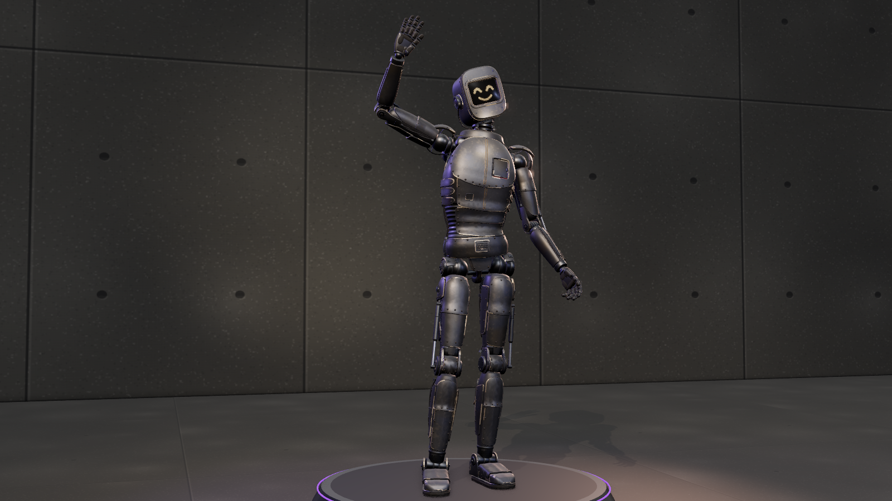

# N1CK (v1, archived)

> Archived earlier version (forged-iron body with welds and rivets, framed screen face), kept for reference. The current N1CK is in [`../n1ck/`](../n1ck/).
> The Unity scripts it was built with are `unity/Runtime/N1CK.cs` and `unity/Editor/N1CKAvatarBuilder.cs` as of commit `18e94c0`.

A playable operator: a 1.85 m robot built for warmth, with a screen for a face. He is lean, with big rounded domed
shoulders, a slight V-taper to the hips and an easy, open stance, and made of dark raw forged iron: satin blue-black
mill scale with small flaked spots, hammered patches and grinder streaks, bright worn bare-iron edges, low weld seams
with crescent ripples and a straw-to-blue heat band, rivet rows, exposed actuators and pistons at the elbows, knees
and hips, and braided cable bundles. His face is a black LED screen deep in a thick stepped iron bezel. Dark red
energy with purple edges glows faintly in the two Nullfield emitter discs on his upper back (behind fine grilles; they
flare a hotter red when the field is up) and in the Veinite power cell, which sits half sunk in a riveted iron cradle
low on his back. The cell is wrapped in a bright brushed stainless shroud with wide windows onto the core, the one
different metal on him (stainless blocks Veinite's hivemind effect). From the front, a thin dark red line leaks round
the chest door and a purple hairline glows between two neck rings. The hinged chest door hides the only writing on
him: "Nick", scratched in a child's hand.

230.8k triangles (head 31.7k, torso 57.6k, arms 59.3k, legs 82.2k). Rigid parts on a Unity-Humanoid-mappable
skeleton; the Unity copy merges them into one skinned mesh per LOD. Rest pose is a T-pose.

## Files

| File | Contents |
| --- | --- |
| `n1ck.glb` | The rig at rest (T-pose) with every mesh under its bone, 18 PBR materials with embedded maps, the face screen as its own mesh and material (with a thin glass pane in front), and all 9 clips. Origin on the ground between his feet, facing +Z, up +Y, his left +X. |
| `unity/n1ck.glb` | Game-ready copy: one skinned mesh per LOD (every part 100% on its bone), LOD0/1/2 with 230.8k / 61.6k / 30.0k triangles and 18 / 15 / 13 draw calls (the stainless shroud and the glows are kept at every LOD), 22 box colliders (hitboxes) on the body bones. |
| `textures/` | `face-atlas.png` (the expression atlas) and every texture sheet as PNG (albedo, normal, ORM per material family; glow gradients; the "Nick" scratch). All are also embedded in the .glb files. |
| `INTEGRATION.md` | Rig, materials, face atlas, clips, Unity setup and how to rebuild. |
| `viewer.html` | Interactive viewer and the procedural source of everything above. |

Unity: `../../unity/Runtime/N1CK.cs` (faces, alarm, emitters, cell glow, clips), `../../unity/Editor/N1CKAvatarBuilder.cs`
(Humanoid Avatar for retargeting). Give him a `NullfieldCarrier` (from `../../unity/Runtime/Nullfield.cs`) too, added
in code with `AddComponent<NullfieldCarrier>()` (see INTEGRATION.md, Unity setup).

## Clips

| Clip | Length | Loop | What happens | Face |
| --- | --- | --- | --- | --- |
| `idle` | 4.0 s | yes | Weight on his left leg, right foot easy and forward, chest counter-turned; one breath, a weight settle, a curious look round | neutral, 3 blinks |
| `walk` | 1.1 s | yes | One full cycle in place at 1.3 m/s (move the root), arms swing | happy, 1 blink |
| `talk_gesture` | 4.0 s | yes | In front of the chest: palms-up offer, a beat with a wrist flick, an index point, a two-hand frame, palm to the chest, explaining chops; the chest turns toward the gesturing hand and leans into the points, shoulders lift on the beats, nods | talk_a / talk_b flaps, the odd happy |
| `wave` | 2.4 s | no | Weight onto the left leg, right arm up and out, hand above the head, three waves from the elbow, head tilted toward the hand, the free arm easy in front, back down | happy |
| `laugh` | 2.0 s | no | Leans back with the head thrown back, then folds well forward, hand flat on the belly, slaps his thigh; the shoulders bounce in step with the face | laughing_a / _b at about 7 Hz |
| `sad` | 3.0 s | no | A slump through the whole spine, shoulders dropped and rolled forward, head down, knees soft, arms heavy, a slow sigh, the right hand closes and lets go | sad |
| `worried` | 2.6 s | no | Hunched with the shoulders up, hands wringing in front of the chest (palms a few cm apart, thumbs and fingers rubbing), glances left and right | worried |
| `alert` | 1.6 s | no | Startled hop into a ready stance, hands up, looks around | alert (red), screen tint up to 0.8 |
| `nullfield_activate` | 1.8 s | no | Braces in the knees, fists close, shoulders roll well back to bare the emitters, chest out, chin up, both fists planted on the hips | focus, emitters 0 → 1 at 0.9 s → 0.6 |

Every one-shot starts and ends on `idle` at 0 s, so crossfades are clean. No clip has root motion, and planted feet
never slide.

## Faces

A 4 × 4 atlas of 32 × 24 warm off-white LEDs (alert cells in red), drawn large with strokes about two LEDs thick so
the face reads from a distance; the outer ring of LEDs in every cell stays dark. The screen UVs cover cell 0; offset
the texture by whole cells to swap faces.

| | col 0 | col 1 | col 2 | col 3 |
| --- | --- | --- | --- | --- |
| row 0 | 0 `neutral` | 1 `neutral_blink` | 2 `happy` | 3 `happy_blink` |
| row 1 | 4 `worried` | 5 `worried_blink` | 6 `laughing_a` | 7 `laughing_b` |
| row 2 | 8 `sad` | 9 `sad_blink` | 10 `alert` | 11 `alert_blink` |
| row 3 | 12 `talk_a` | 13 `talk_b` | 14 `focus` | 15 `off` |

Alarm tints the whole screen toward dark red (`#d8141a`).

## Viewer

Clip buttons, expressions (Auto follows the clip), toggles for Alarm, Nullfield (emitters flare) and Chest (opens the
panel and frames "Nick"), views Full, Face, Hands and Back, and Orbit (slow turntable).
