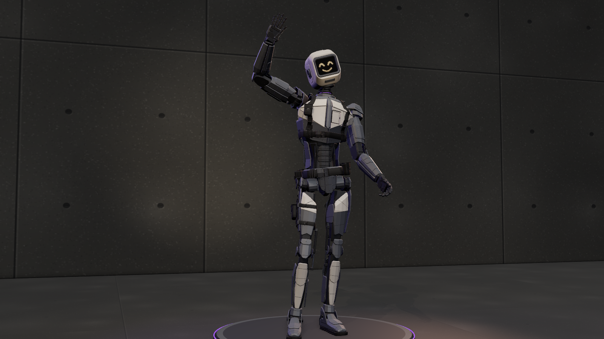

# N1CK (v2, archived)

> Archived earlier version (sleek painted-armour body with tactical gear, framed screen head with pixel faces), kept for reference. The current N1CK is in [`../n1ck/`](../n1ck/).
> The Unity scripts it was built with are `unity/Runtime/N1CK.cs` and `unity/Editor/N1CKAvatarBuilder.cs` as of commit `1f70c8b`.

A playable operator: a 1.85 m robot built for warmth, with a screen for a face. He is an agile soldier-robot, lean
and athletic, with a clear V-taper: squared but not bulky shoulders, a narrow exposed waist and long, slim limbs. His
armour is sleek and angular: a few big planar facets per plate with crisp chamfered edges, layered and overlapping
(a wedge knee cap under a lip plate, a layered fauld at the pelvis, stepped back plates), with tight panel gaps and
recessed panel lines, over a slim dark mechanical frame that shows at the gaps (a segmented ab stack and spine
column at the waist, cable bundles, small pistons, and exposed actuators at the elbows, knees and hips, where a
machined ball sits in a faceted socket cup). The armour is clean matte paint in two tones: dark slate on most plates,
warm light grey on the layered chest plates, the upper thigh plates, the forearm tops, the shin fronts, the scapulas
and the head, so he reads at range from the front and the back. Wear is light: a few clusters of chipped paint on
exposed edges and plate corners down to dull grey metal, faint scuffs, a little grime in the panel lines. Chrome
appears only on the piston rods. His hands have a dorsal armour plate on every finger segment (a nail bevel at the
tip) over a slim dark core, and a knuckle guard over the back of the hand. His boots are slim armoured tactical boots
with a lugged rubber sole, a ridged, tapered toe cap and a raked cuff round the ankle.

Over the armour he wears tactical gear: a 50 mm duty belt with two magazine pouches at his left hip (one in front of
it, one behind, clear of the thigh in a crouch), a zip utility pouch, a D-ring and MOLLE loops; a chest harness
(chest band, shoulder straps with ladder locks and daisy loops, a radio pouch on the right strap, a back yoke and
strap); and a drop-leg panel with a magazine pouch on his right thigh. The webbing is near-black nylon with stitched
edges, so the gear reads as a dark band against the slate paint, the pouches are a fine-weave fabric, and the
side-release buckles and sliders are black polymer.

His head is a light rounded-rectangle housing with crisp bevels, a dark faceted chin plate and a dark bezel round a
recessed LED screen behind a thin glass pane, with a speaker ear on the left and a microphone ear with a stub antenna on the right, on a wide
segmented neck. Dark red energy with purple edges glows faintly in the two Nullfield emitters on his upper back
(recessed behind thin radial blades; they flare a hotter red when the field is up) and in the Veinite power cell low on his back.
The cell sits in a bright brushed stainless cage, the one bright metal on him (stainless blocks Veinite's hivemind
effect). A thin dark red line shows under the shut chest door, and a purple hairline glows in his neck. The hinged
chest door (recessed, with a barrel hinge and a finger notch) hides the only writing on him: "Nick", scratched in a
child's hand.

138.4k triangles (head 16.6k, torso 37.3k, arms 27.8k, legs 34.0k, gear 22.8k). Rigid parts on a
Unity-Humanoid-mappable skeleton; the Unity copy merges them into one skinned mesh per LOD. Rest pose is a T-pose.

## Files

| File | Contents |
| --- | --- |
| `n1ck.glb` | The rig at rest (T-pose) with every mesh under its bone (513 meshes; the gear meshes are named `gear_*`), 19 PBR materials with embedded maps, the face screen as its own mesh and material (with a thin glass pane in front), and all 9 clips. Origin on the ground between his feet, facing +Z, up +Y, his left +X. 16.2 MB. |
| `unity/n1ck.glb` | Game-ready copy: one skinned mesh per LOD (every part 100% on its bone), LOD0/1/2 with 138.4k / 49.4k / 34.3k triangles and 19 / 17 / 16 draw calls (the stainless shroud, the glows, the webbing, the pouches, the head and the hips are kept at every LOD; no flipped triangles), 20 box colliders (hitboxes) on the body bones. 23.7 MB. |
| `textures/` | `face-atlas.png` (the expression atlas) and every texture sheet as PNG (albedo, normal, ORM per material family; glow gradients; the "Nick" scratch), each identical to the image embedded in the .glb files (same orientation). |
| `INTEGRATION.md` | Rig, gear, materials, face atlas, clips, Unity setup and how to rebuild. |
| `viewer.html` | Interactive viewer and the procedural source of everything above. |

Unity: `../../unity/Runtime/N1CK.cs` (faces, alarm, emitters, cell glow, clips), `../../unity/Editor/N1CKAvatarBuilder.cs`
(Humanoid Avatar for retargeting). Give him a `NullfieldCarrier` (from `../../unity/Runtime/Nullfield.cs`) too, added
in code with `AddComponent<NullfieldCarrier>()` (see INTEGRATION.md, Unity setup).

## Clips

| Clip | Length | Loop | What happens | Face |
| --- | --- | --- | --- | --- |
| `idle` | 4.0 s | yes | Weight on his left leg (pelvis shifted and rolled over it), right foot easy, forward and turned out, chest lifted and counter-turned, arms hanging close with soft elbows; one breath, a weight settle, a curious look round | neutral, 3 blinks |
| `walk` | 1.1 s | yes | One full cycle in place at 1.3 m/s (move the root), arms swing | happy, 1 blink |
| `talk_gesture` | 4.0 s | yes | In front of the chest: palms-up offer, a beat with a wrist flick, an index point, a two-hand frame, palm to the chest, explaining chops; the chest turns toward the gesturing hand and leans into the points, shoulders lift on the beats, nods | talk_a / talk_b flaps, the odd happy |
| `wave` | 2.4 s | no | Weight onto the left leg, right arm up and out, hand above the head, three waves from the elbow, head tilted toward the hand, the free arm easy in front, back down | happy |
| `laugh` | 2.0 s | no | Leans back with the head thrown back, then folds well forward, left hand flat on his stomach above the belt, slaps his thigh; the shoulders bounce in step with the face | laughing_a / _b at about 7 Hz |
| `sad` | 3.0 s | no | A slump through the whole spine, shoulders dropped and rolled forward, head down, knees soft, arms heavy, a slow sigh, the right hand closes and lets go | sad |
| `worried` | 2.6 s | no | Hunched with the shoulders up, hands wringing in front of the chest (palms a few cm apart, thumbs and fingers rubbing), glances left and right | worried |
| `alert` | 1.6 s | no | Startled hop into a ready stance loaded forward (hips back, trunk leaning in, screen level), hands up in loose fists, looks around | alert (red), screen tint up to 0.8 |
| `nullfield_activate` | 1.8 s | no | Braces in the knees, fists close in front of his stomach, shoulders roll well back to bare the emitters, chest out with the trunk still loaded forward; the fists arc over the front pouch and plant on his hips, knuckles on the belt | focus, emitters 0 → 1 at 0.9 s → 0.6 |

Every one-shot starts and ends on `idle` at 0 s, so crossfades are clean. No clip has root motion, and planted feet
never slide or lift off the floor.

## Faces

A 4 × 4 atlas of 32 × 24 warm off-white LEDs (alert cells in red), drawn large with strokes about two LEDs thick so
the face reads from a distance; the outer ring of LEDs in every cell stays dark. The screen UVs cover cell 0; offset
the texture by whole cells to swap faces.

| | col 0 | col 1 | col 2 | col 3 |
| --- | --- | --- | --- | --- |
| row 0 | 0 `neutral` | 1 `neutral_blink` | 2 `happy` | 3 `happy_blink` |
| row 1 | 4 `worried` | 5 `worried_blink` | 6 `laughing_a` | 7 `laughing_b` |
| row 2 | 8 `sad` | 9 `sad_blink` | 10 `alert` | 11 `alert_blink` |
| row 3 | 12 `talk_a` | 13 `talk_b` | 14 `focus` | 15 `off` |

Alarm tints the whole screen toward dark red (`#d8141a`).

## Viewer

Clip buttons, expressions (Auto follows the clip), toggles for Alarm, Nullfield (emitters flare), Chest (opens the
panel and frames "Nick") and Gear (off shows the bare armour), views Full, Face, Hands and Back, and Orbit (slow
turntable).
