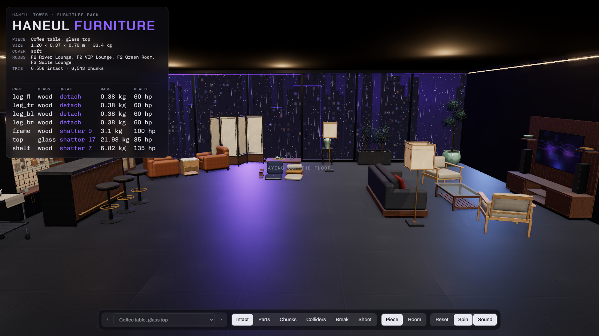
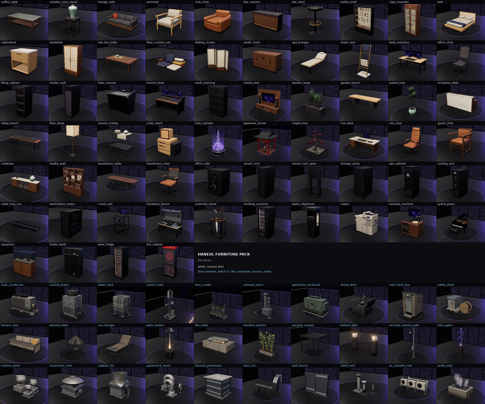

# Haneul Tower furniture pack

Breakable furniture for the Haneul Tower map: the upper floors of a 2111 Seoul supertall by the river, at night,
in the rain. You place every piece yourself; nothing here is placed in the map. Warm wood, hanji paper panels,
celadon, brass, dark alloy and stone, with tech pieces (render racks, holo console, broadcast desk) in graphite and
dark alloy with a few purple `#8a4dff` lights. No text, logos, numbers or symbols anywhere.

**37 pieces**, one `.glb` each. Every piece is built from named parts (317 in all) that come apart.
The 121 parts that would shatter (wood tops, glass, ceramic, screens, stone, paper, soil) carry pre-cut chunk sets
(908 chunks in all) that the game swaps in when that part breaks, plus a few debris bits. Wood splits along the
grain with saw-toothed ends (board by board), glass breaks radially round an impact (tempered glass dices), screens
crack in their housings, hanji tears into ragged strips (a border strip stays on the frame), upholstery tears along
its seams with recessed foam, and chunks of lights and screens are dark.
Each part has a material class (for impact sounds and effects), a mass, a health value and collider proxies.
307,402 triangles intact across the pack, 298,643 in the chunk sets.

**Batch E:** `holo_cylinder` (stepped alloy projector plinth with purple LED lines, eight emitter heads and a lens array under a see-through layered purple hologram column with a wireframe model of the tower; the hologram casts no shadow and switches off when the lens is shot), `japanese_shrine` (indoor shrine pavilion for double-height rooms, 3.2 × 3.8 × 3.2 m: vermilion pillars, bracketed head beams and an irimoya hip-and-gable tiled roof with upturned corners over a walnut deck on a granite plinth; mirror altar, sakaki vases, paper andon, suzu bell and rope, offering box, purple LED cove; about 29k triangles, over the 15k guideline as a room-sized hero piece) and `maple_tree` (cloud-pruned red Japanese maple on a gnarled trunk with six flat leaf pads of 2D alpha cards, in a low basalt bed with raked gravel, moss, stones and a warm LED washer). Same naming, parts, chunks and colliders as every other piece; their entries are in `parts.json` and their parts tables in `INTEGRATION.md`.

| id | Piece | Size (m) | kg | Cover | Triangles | Parts |
| --- | --- | --- | --- | --- | --- | --- |
| `holo_cylinder` | Hologram cylinder | 1.12 × 2.02 × 1.13 | 159.6 | none | 13,784 / 18,326 | 4 |
| `japanese_shrine` | Japanese shrine pavilion | 3.19 × 3.78 × 3.19 | 3,087.7 | soft | 29,248 / 36,934 | 27 |
| `maple_tree` | Red maple in a garden bed | 2.30 × 2.33 × 1.63 | 453 | soft | 13,102 / 13,476 | 9 |

## Files

| File | Contents |
| --- | --- |
| `glb/<id>.glb` | One piece per file. Origin on the floor under the middle of the footprint, front +Z, up +Y, metres, real size. Parts, hidden chunk sets, hidden debris and `col_*` collider proxies, all by name. Metadata in the glTF extras. |
| `unity/<id>.glb` | Game-ready copies: meshes merged per node, LOD0–2, `_COL` boxes and `_HULL` convex hulls (one per chunk). Driven in Unity by `../../unity/Runtime/BreakableFurniture.cs`. |
| `parts.json` | Every piece's metadata: parts, material class, mass, health, break type, support links, bullet stopping, chunks, debris, colliders; plus the class and material tables. `BreakableFurniture.cs` reads it. |
| `sounds/` | A hit and a break sound for each material class, and rifle, shotgun and frag sounds (44.1 kHz mono WAV), plus `generate_sounds.py`, which makes them. |
| `catalogue.png` | Contact sheet of the first 34 pieces (the three batch E pieces are below). |
| `INTEGRATION.md` | How to place pieces, the naming contract, how breaking works, the Unity script, a parts table for every piece, and how to rebuild. |
| `viewer.html` | The catalogue viewer, and the procedural source every file is exported from. |

## Pieces

Size is W × H × D in metres (x × y × z). Cover: **none** (does not hide a body), **soft** (hides you, never stops
bullets: ordinary furniture, as in Siege), **hard** (has parts that stop bullets). The garden bench is soft cover,
but its two granite plinths stop bullets. Triangles are intact / chunk sets.

| id | Piece | Size (m) | kg | Cover | Triangles | Parts | File | Rooms |
| --- | --- | --- | --- | --- | --- | --- | --- | --- |
| `coffee_table` | Coffee table, glass top | 1.20 × 0.37 × 0.70 | 33.4 | soft | 6,556 / 6,543 | 7 | 897 KB | F2 River Lounge, F2 VIP Lounge, F2 Green Room, F3 Suite Lounge |
| `celadon_vase_stand` | Celadon vase on stand | 0.40 × 1.00 × 0.40 | 11 | soft | 9,084 / 10,957 | 8 | 1167 KB | F3 Exec Hall, F1 Tea Room, F2 Reception, F3 Boardroom |
| `lounge_sofa` | Low lounge sofa, 3 seat | 2.20 × 0.80 × 0.92 | 59.5 | soft | 13,464 / 16,280 | 10 | 1447 KB | F2 River Lounge, F2 VIP Lounge, F2 Green Room, F2 Noraebang, F2 Booth 1, F2 Booth 2, F3 Suite Lounge |
| `armchair` | Oak-frame lounge armchair | 0.81 × 0.80 × 0.85 | 13.7 | soft | 8,056 / 4,456 | 7 | 884 KB | F2 VIP Lounge, F2 River Lounge, F2 Green Room, F3 Exec Office, F3 Suite Lounge |
| `club_chair` | Leather club chair | 0.90 × 0.78 × 0.92 | 28.2 | soft | 9,988 / 22,847 | 6 | 1520 KB | F2 Cigar Room, F2 Wine Room, F2 Lounge Bar, F3 Exec Office |
| `bar_counter` | Bar counter module (2 m, fluted front) | 2.00 × 1.10 × 0.71 | 165.5 | soft | 5,256 / 12,279 | 6 | 1437 KB | F2 Lounge Bar, F2 Wine Room, F2 Noraebang, F3 Foyer |
| `bar_stool` | Bar stool | 0.44 × 0.78 × 0.44 | 13 | none | 3,448 / 0 | 4 | 256 KB | F2 Lounge Bar, F2 Wine Room, F3 Foyer |
| `bottle_shelf` | Back-bar bottle shelf, backlit | 1.60 × 2.21 × 0.41 | 78.4 | soft | 15,024 / 29,908 | 29 | 3646 KB | F2 Lounge Bar, F2 Wine Room, F2 Noraebang |
| `cigar_humidor` | Cigar humidor cabinet, glass doors | 0.92 × 2.00 × 0.54 | 72.9 | soft | 13,352 / 2,755 | 16 | 1410 KB | F2 Cigar Room, F2 Wine Room |
| `bed` | Platform bed with hanji headboard | 1.80 × 1.05 × 2.20 | 82.8 | soft | 6,692 / 9,370 | 8 | 1311 KB | F3 Bedroom |
| `nightstand` | Nightstand with drawer | 0.50 × 0.52 × 0.43 | 16.5 | soft | 1,704 / 1,539 | 3 | 650 KB | F3 Bedroom, F3 Suite Lounge |
| `wardrobe` | Wardrobe, lattice-and-hanji doors | 1.20 × 2.20 × 0.61 | 87.6 | soft | 5,448 / 9,738 | 8 | 1450 KB | F3 Bedroom, F3 Suite Bath, F2 Wardrobe, F2 Cloakroom |
| `low_tea_table` | Low tea table with celadon tea set | 1.20 × 0.46 × 0.70 | 21.5 | soft | 7,724 / 12,002 | 12 | 1647 KB | F1 Tea Room, F1 Ondol Lounge, F2 VIP Lounge |
| `floor_cushion_set` | Ondol floor cushion set | 1.36 × 0.45 × 1.02 | 9.3 | none | 12,840 / 0 | 7 | 657 KB | F1 Ondol Lounge, F1 Tea Room |
| `folding_screen` | Four-panel hanji folding screen | 1.98 × 1.80 × 0.44 | 13.2 | soft | 4,548 / 7,352 | 8 | 1261 KB | F1 Tea Room, F1 Ondol Lounge, F2 River Lounge, F3 Suite Lounge |
| `ondol_chest` | Low ondol cabinet (bandaji-style chest) | 1.05 × 0.60 × 0.46 | 38 | soft | 10,600 / 4,884 | 5 | 1023 KB | F1 Ondol Lounge, F1 Tea Room, F3 Exec Hall |
| `spa_lounger` | Spa lounger | 0.77 × 0.87 × 1.96 | 23.6 | soft | 7,472 / 2,931 | 4 | 877 KB | F1 Bathhouse, F1 Steam Room, F1 Treatment, F1 Veranda |
| `towel_rack` | Free-standing towel rack | 0.58 × 1.50 × 0.43 | 26.2 | none | 2,836 / 691 | 5 | 397 KB | F1 Changing, F1 Bathhouse, F1 Steam Room, F1 Lockers, F3 Suite Bath |
| `desk_monitors` | Desk with two monitors | 1.60 × 1.20 × 0.80 | 44.3 | soft | 5,768 / 2,446 | 12 | 956 KB | F3 Newsroom, F3 Edit Bay, F3 Edit 1, F3 Edit 2, F3 Writers Room, F3 Exec Office, F3 Podcast |
| `office_chair` | Task chair | 0.66 × 1.15 × 0.69 | 12.6 | none | 11,588 / 0 | 7 | 605 KB | F3 Newsroom, F3 Edit Bay, F3 Control Room, F3 Writers Room, F3 Podcast |
| `filing_cabinet` | Four-drawer filing cabinet | 0.45 × 1.30 × 0.64 | 45 | soft | 3,264 / 0 | 5 | 175 KB | F3 Archive, F3 Writers Room, F3 Newsroom, F3 Exec Office |
| `render_rack` | Render-farm rack | 0.60 × 2.20 × 1.10 | 217 | hard | 14,660 / 950 | 14 | 1026 KB | F3 Render Farm, F3 Edit 2, F3 Projection, F2 Studio |
| `holo_console` | Holo stage console | 1.20 × 1.05 × 0.80 | 57.5 | soft | 3,620 / 2,436 | 6 | 541 KB | F3 Control Room, F3 Screening, F2 Studio |
| `control_desk` | Broadcast control desk module | 1.80 × 1.30 × 0.95 | 71 | soft | 7,440 / 5,453 | 9 | 1153 KB | F3 Control Room, F3 Edit Bay, F3 Projection |
| `vault_shelving` | Deposit-box shelving | 1.20 × 2.10 × 0.61 | 214 | hard | 9,948 / 0 | 17 | 531 KB | F2 Deposit, F2 Concierge, F3 Archive |
| `media_wall` | Media wall unit | 2.40 × 2.00 × 0.46 | 75.8 | soft | 5,412 / 8,867 | 9 | 1543 KB | F3 Suite Lounge, F3 Exec Office, F3 Boardroom, F3 Foyer, F2 Green Room, F2 VIP Lounge |
| `planter_large` | Large basalt planter with shrub | 1.27 × 1.70 × 0.61 | 289 | hard | 8,644 / 13,633 | 5 | 1384 KB | F2 Gallery, F2 Reception, F2 Bridge Lobby, F1 Veranda, F1 Garden |
| `garden_bench` | Stone and oak garden bench | 1.80 × 0.45 × 0.50 | 188 | soft | 1,632 / 1,613 | 3 | 470 KB | F1 Garden, F1 Veranda, F2 Bridge Lobby, F2 Gallery |
| `potted_tree` | Potted tree | 1.04 × 2.45 × 0.80 | 57 | soft | 4,508 / 5,676 | 6 | 764 KB | F2 Reception, F2 River Lounge, F2 Lounge Bar, F3 Exec Hall, F3 Suite Lounge |
| `reception_desk` | Reception desk (stone front) | 2.40 × 1.10 × 0.85 | 172.5 | soft | 2,812 / 4,524 | 8 | 891 KB | F2 Reception, F2 Concierge, F2 Security, F2 Cloakroom, F3 Foyer |
| `lobby_bench` | Lift-lobby bench | 1.80 × 0.44 × 0.55 | 27 | soft | 5,256 / 3,816 | 4 | 824 KB | F1 Garden Lifts, F2 Sky Lifts, F3 Media Lifts, F2 Bridge Lobby, F3 Archive Hall |
| `floor_lamp` | Hanji lantern floor lamp | 0.45 × 1.65 × 0.45 | 11.3 | none | 3,172 / 3,604 | 5 | 703 KB | F1 Tea Room, F1 Ondol Lounge, F2 River Lounge, F2 VIP Lounge, F3 Bedroom, F3 Suite Lounge |
| `service_trolley` | Service trolley | 0.88 × 0.99 × 0.58 | 18.4 | soft | 9,344 / 11,363 | 10 | 1214 KB | F1 Kitchen, F1 Servery, F1 Kitchen Pass, F1 Laundry, F1 Dining Room, F2 Backstage |
| `crate_stack` | Stacked crates and a flight case | 1.21 × 1.40 × 0.80 | 41 | soft | 10,108 / 10,994 | 4 | 1468 KB | F1 Plant Room, F1 Staff Entry, F1 Laundry, F1 Kitchen, F2 Studio, F2 Backstage, F2 Wardrobe |

## Viewer

Open `viewer.html` in a browser (it needs the network for three.js). It is a dark high-rise room with rain on the
window and the city behind it. **Piece** view puts one piece on a turntable; pick it from the list or with ← →.
Modes:

- **Intact**
- **Parts**: pulled apart
- **Chunks**: the pre-cut chunk sets spread out, with the debris beside them
- **Colliders**: the proxies as wireframes
- **Break**: a looping demo of everything breaking at once
- **Shoot**: click a part to damage it with **Rifle** (40 per round), **Shotgun** (8 pellets of 12) or **Frag** (300 at the centre, falling to nothing at 4 m)

In Shoot mode the parts table shows each part's health as it drops. A part comes loose or swaps to chunks at 0,
following its break type and support links, and falls with simple gravity, bounce and spin (there is no physics
library and loose bodies do not collide with each other). A loose glass, ceramic or electronic part that lands
hard takes damage. Broken lights and screens go dark.

**Room** view lays out a sample suite with 23 copies of the pieces: a lounge facing the media wall, a bar, a
cigar corner and a tea corner by the window. You can shoot it too. Keys: 1–6 modes, R reset. There are **Spin**
(turntable) and **Sound** toggles.
