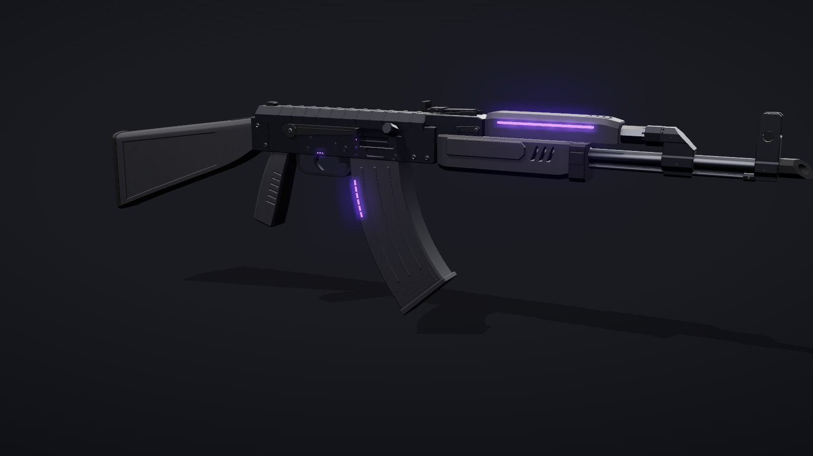

# AK-47 (AKM pattern)

A Kalashnikov in the AKM pattern, the form most people mean by "AK-47": a ribbed dust cover, the 45-degree
gas block, the slant compensator, a tangent-leaf rear sight, a fixed stock with a pistol grip and a curved
30-round magazine.

It is finished in the faction's sci-fi look (the same as the
[Wall Fortification](../../gadgets/wall-fortification/)): the same rifle with the same outline, dimensions and
mechanism, but with new surfaces.

- **Receiver:** machined alloy in place of the stamped sheet, with a 1 mm chamfer on every edge. Panel seams
  mark off the rear and front trunnion blocks and wrap under the receiver, and chamfered pockets sit where the
  stamped receiver has its magazine-well dimples. The charging-handle slot and the ejection port have a
  chamfered rim.
- **Dust cover:** a flat top between 45-degree facets, eleven crisp flat-topped ribs across it and a machined
  bead along the deep left flange.
- **LEDs:** a purple strip sits in a channel along the left side seam, just under the dust cover's flange, and
  an accent line runs along each side of the upper handguard. Three status pips sit above the trigger guard,
  and a six-segment ammo indicator runs down the magazine's spine on both sides.
- **Selector marks:** geometric marks under the lever's sweep, behind the ejection port: a dot for safe, three
  bars for auto and one bar for semi. Each mark is an LED pip set in an engraved socket, and the first mark
  showing below the lever's tip is always the position it is in.
- **Handguards:** faceted composite. The lower one has raised grip panels where the AKM has its palm swells and
  three raked vent slots ahead of them. The upper one has a flat top between broad facets and four chevron vents
  over the gas tube.
- **Gas system and muzzle:** the gas tube and its coupling, the gas block's barrel ring and cylinder, the
  front-sight collar, the cleaning-rod head and the slant compensator are octagonal, with crisp chamfered ends.
  The compensator keeps its single 45-degree cut.
- **Stock and grip:** the stock has flat sides with a machined recess in each, a chamfered belly and a soft comb
  where the cheek goes. The grip has flat sides with machined traction grooves, a chamfered front strap and a
  round backstrap. The steel buttplate is chamfered round its edge.
- **Sights:** purple tritium-style dots, one on the rear face of the front post and two either side of the rear
  notch.
- **Hardware:** every screw has a real hex-socket recess cut into it. The trunnion rivets became hex-socket
  screws, the centre-support and lower front-trunnion rivets became flush machined plugs, and the right-hand
  fire-control pin ends sit flush in counterbores.

There is no text, logo or marking anywhere on the rifle or the cartridge.

## Specs

| | |
| --- | --- |
| Cartridge | 7.62×39 mm |
| Barrel | 415 mm (16.3"), breech face to muzzle |
| Overall length | 897 mm (35.3") over the slant compensator; 880 mm to the muzzle |
| Sight radius | 378 mm (14.9"), sight line 48.5 mm above the bore |
| Length of pull | 12.6" (Warsaw-length stock) |
| Height with magazine | 265 mm (10.4") |
| Charging handle travel | 90 mm |

Dimensions come from spec listings, armorer layout prints and forum caliper measurements: the
receiver and trunnion rivet layout, fire-control pin positions, barrel journal diameters, gas-tube
and handguard lengths, front-sight-base and compensator sizes, and stock and magazine envelopes.
Small details that no source measured (rib counts, grip shape) are close approximations.

Sources: [AKM](https://en.wikipedia.org/wiki/AKM) (415 mm barrel, 880 mm length, 378 mm sight radius) and
[7.62×39mm](https://en.wikipedia.org/wiki/7.62%C3%9739mm) (38.7 mm case, 56.0 mm overall, 11.35 mm rim, 7.92 mm
CIP bullet diameter). The restyle kept every outside dimension. Only the receiver's walls changed: they are
modelled 2.5 mm thick as a machined part, where the stamped AKM uses 1 mm sheet.

## Files

| File | Contents |
| --- | --- |
| `ak47.glb` | The rifle (1.6 MB): 0.897 m long, 96 named meshes, about 52k triangles, with three animations: `charge` (0.38 s: the carrier and charging handle run back 90 mm and slam home), `selector_safe_auto_semi` (0.9 s: the lever steps down through AUTO to SEMI) and `magazine_release` (0.7 s: the magazine rocks forward off its catch and drops). |
| `cartridge-7.62x39.glb` | A 7.62×39 mm round (70 KB): brass case with extractor groove and 15-degree shoulder, copper-jacketed boat-tail bullet, 56 mm long, with no headstamp. Origin at the centre of the case head, bullet toward +Z. |
| `viewer.html` | Interactive viewer and the procedural source of both files. |
| `preview.png` | Still render. |

## Parts

Nodes in `ak47.glb`. Where a part is made of several meshes they are numbered (`front_sight_2`, ...).

- **Moving:** `bolt_carrier_assembly` (`bolt_carrier`, `bolt`, `charging_handle`), `selector_assembly`
  (`selector_lever`), `magazine_assembly` (`magazine_body`, `magazine_ribs`, `magazine_floorplate`,
  `magazine_catches`, `magazine_top_round`, `magazine_ammo_indicator`)
- **Receiver group:** `receiver`, `trunnions`, `receiver_cavity`, `receiver_screws`, `receiver_plugs`,
  `fire_control_pins`, `receiver_led`, `status_pips`, `selector_mark_safe`, `selector_mark_auto`,
  `selector_mark_semi`, `dust_cover`, `dust_cover_bead`, `recoil_spring_button`
- **Trigger group:** `trigger_guard`, `trigger`, `magazine_release`, `pistol_grip`, `grip_screw`
- **Barrel group:** `barrel`, `rear_sight_block`, `rear_sight_base`, `rear_sight_leaf`, `rear_sight_dots`,
  `rear_sight_slider`, `gas_tube_lever`, `gas_tube`, `gas_block`, `gas_block_pin`, `front_sight`,
  `front_sight_dot`, `muzzle_brake`, `cleaning_rod`
- **Furniture:** `upper_handguard`, `handguard_led`, `lower_handguard`, `handguard_ferrule`, `ferrule_lever`,
  `front_sling_loop`, `stock`, `stock_tang`, `stock_screws`, `buttplate`, `buttplate_ribs`,
  `buttplate_trapdoor`, `buttplate_screws`, `rear_sling_loop`, `sling_loop_screws`

The stamped version's `rivets` part is gone: its heads became `receiver_screws` and `receiver_plugs`.

The ammo indicator is six meshes, `magazine_ammo_indicator` (top) to `magazine_ammo_indicator_6` (bottom), and
each one lights its segment on both sides of the magazine. A segment stands for five rounds, and they go dark
from the top as the magazine empties. All six ship lit, and so do the three selector marks; hide or dim them to
show the count or the active position.

Materials: `frame_alloy`, `shell_composite`, `barrel_steel`, `black_steel`, `fasteners`, `led_purple`
(emissive, `KHR_materials_emissive_strength` 2.6) and `void`. The top round in the magazine and the cartridge
use `case_brass` and `bullet_jacket`.

## Viewer

Open `viewer.html` in a browser.

- Drag to orbit, scroll to zoom, right-drag to pan.
- **Charge** (R or Space) pulls the charging handle and ejects a round. On SAFE the selector blocks it. The
  ammo indicator counts down as rounds feed.
- **Selector** (F) steps through safe, auto and semi, and only the mark for the active position stays lit.
- **Drop mag** (M) rocks the magazine off its catch and drops it; press again to insert it.
- The furniture and magazine come in Graphite (as exported), Arctic and Sand. The LEDs stay purple.
- Part labels, preset views (three-quarter, right, left, top) and a turntable. The LEDs get a soft glow in the
  viewer; the glow is not stored in the `.glb`.
