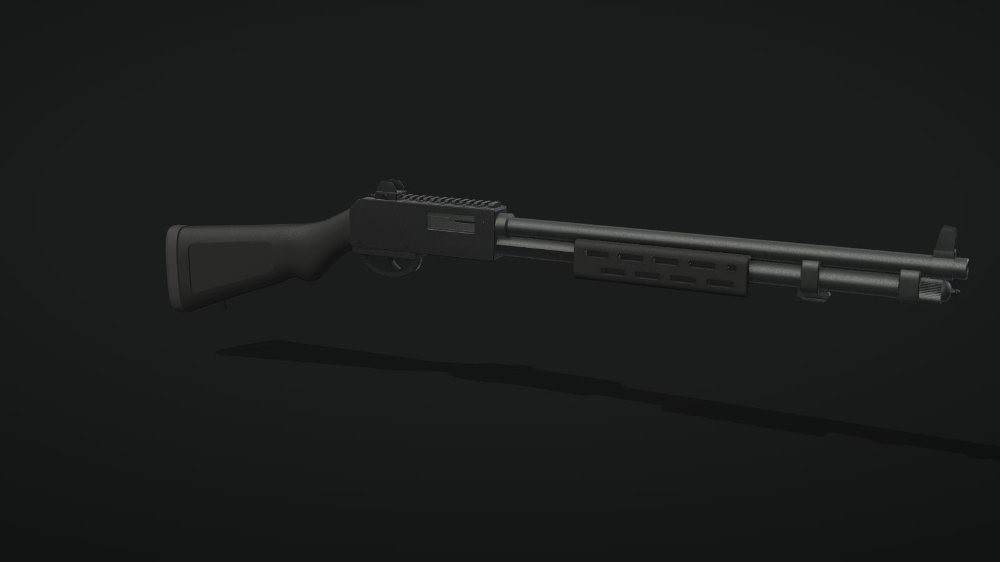

# Mossberg 590A1

A 12-gauge pump-action shotgun in matte black, set up the way the owner's gun is: a plain 20" heavy
barrel with no heat shield, an M-LOK forend, a Picatinny rail on the receiver carrying a ghost ring
rear sight, a protected front post, a metal trigger guard, a synthetic stock with a semi-pistol grip,
a bayonet-lug band and a knurled magazine cap with a sling stud.

## Specs

| | |
| --- | --- |
| Gauge | 12, 3" chamber |
| Barrel | 20" heavy wall, cylinder bore |
| Overall length | 41.0" (1.041 m) |
| Length of pull | 13.87" |
| Capacity | 8 + 1 with 2 3/4" shells |
| Sights | ghost ring on the receiver rail, protected front post |
| Forend | M-LOK, two staggered rows of slots |
| Pump stroke | 3.6" (91 mm) |

Proportions come from published specs ([Gun Tests](https://www.gun-tests.com/news/long_guns/Mossberg-590A1-Tactical-Shotguns_11030-1.html),
[Sportsman's Warehouse](https://www.sportsmans.com/shooting-gear-gun-supplies/shotguns/mossberg-590a1-parkerized-12-gauge-3in-pump-action-shotgun-20in/p/1477346))
and were traced from a reference photo of the real gun. Small details are close approximations.

## Files

| File | Contents |
| --- | --- |
| `m590a1.glb` | The shotgun. 1.041 m long, 44 named meshes, about 101k triangles. One animation, `rack` (0.47 s): the forend and bolt slide back 91 mm and return. |
| `shell-12ga.glb` | A 2 3/4" 12-gauge shell, unfired: 63.8 mm long, 22.2 mm rim. Brass head, primer, hull and an 8-point star crimp. Origin at the centre of the base, crimp toward +Z. |
| `viewer.html` | Interactive viewer and the procedural source of both files. |
| `preview.png` | Still render. |

## Parts

Nodes in `m590a1.glb`. Where a part is made of several meshes, they are numbered (`front_sight_2`, ...).

- **Moving:** `forend_assembly` (`forend`, `action_bars`), `bolt_assembly` (`bolt`)
- **Receiver group:** `receiver`, `receiver_cavity`, `rail`, `rear_sight`, `safety`, `elevator`,
  `chamber`, `trigger_pins`
- **Trigger group:** `trigger_housing`, `trigger_guard`, `trigger`, `action_lock_lever`
- **Barrel and tube:** `barrel`, `bore_plug`, `front_sight`, `barrel_lug`, `bayonet_band`,
  `bayonet_lug`, `magazine_tube`, `magazine_cap`
- **Stock:** `stock`, `recoil_pad`, `sling_stud_rear`

Materials: `receiver_finish`, `barrel_steel`, `small_parts`, `bolt_steel`, `bright_steel`, `polymer`,
`rubber`, `void`. The shell uses `shell_brass`, `shell_primer` and `shell_hull`.

## Viewer

Open `viewer.html` in a browser.

- Drag to orbit, scroll to zoom, right-drag to pan.
- **Rack the action** (or press R / Space) cycles the pump and ejects a shell.
- Finishes: matte black (as exported), Parkerized and Tungsten grey.
- Part labels, preset views (three-quarter, right, left, top) and a turntable.
