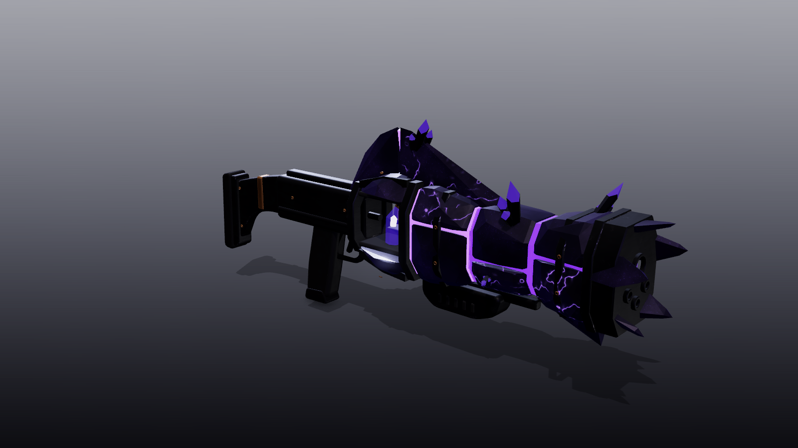

# Nightstone Blaster

An original heavy two-handed scattergun in the Calamity-spirit style (see `.claude/skills/calamity-style`). It is
not a copy of any existing item. A thin forged-iron spine (pistol grip, guard, one curved forged stock spine with a bronze band) carries a big faceted
stone head made of black-violet slabs (three value/hue variants, three of them with glowing violet veins). The head holds an iron chamber cage with a hot core, a six-shard drum on the
left flank, an off-centre crest, a keel, iron bands with bronze rivets, black crystal overgrowth and a muzzle crown
with five stone petals. Each shot fires 7 hitscan bullets plus 3 black crystal shards. The shards fly slower, drop
under gravity and shatter on impact.

| | |
|---|---|
| Size | 0.91 × 0.35 × 0.19 m (L × H × W); the stone head is about 61 % of the length, metres, +Y up, muzzle +Z, origin on the bore above the trigger |
| Triangles | 21,690 (main glb); Unity copy LOD0/1/2 21,690 / 12,931 / 8,760 |
| Tier | between T2 elemental and T4 cosmic: glowing seams, veins, bore rims and crystal tips (roughly 10 % of the visible surface in the hero view), with one near-white hot spot (the core) |
| Palette | stone `#120e18`–`#2a1f3a` with a violet sheen, veins `#3a2d52` (glowing violet in the veined slabs), iron `#1d1d23`, bronze `#a87a48`, seams `#5a2ad0`/`#8a58f6`, core `#efe6ff` |
| Materials | nightstone, nightstone_b, nightstone_c, nightstone_veined (clearcoat with its own undulating normal map, sheen; the veined one has an emissive vein map), forged_iron (+ _worn edges), bronze, grip_wrap, black_crystal, black_crystal_tip, core_hot, core_crystal, seam_glow, seam_glow_hot, bore, crevice |

## Parts (named nodes)
`receiver` (static grip, guard, stock), `trigger`, `head` (it kicks back on fire), `core` (breathes),
`shard_drum` → `drum_shard_0..5`, `pump`, `petal_0..4`. Locators: `muzzle` (bullet and shard origin, +Z forward),
`core_locator`, `grip_attach`, `offhand_attach` (on the pump).

## Clips (30 fps)
| Clip | s | What moves |
|---|---|---|
| idle | 2.4 loop | the core breathes; trigger, head, drum, pump and petals are keyed at rest |
| fire | 0.7 | trigger; shot at 0.04 s; the core flashes; the head kicks back 18 mm and springs home; the petals flare 28°; the drum indexes −60° (0.16–0.36 s) and steps back to 0° on the last frame |
| reload | 1.6 | the pump racks back and returns; the drum spins one full turn; all six drum shards regrow from 20 % |
| inspect | 2.8 | the petals open and close; the drum turns one full turn; the pump makes a half stroke; the core swells |

## VFX (`vfx/`)
Grounded and layered, with no outlines or flat blobs:
- **Crisp objects:** shard meshes, fragments and decals.
- **Soft additive glow:** the flash, the impact glints and a 0.06 s light.
- **Short streaks:** tracers and sparks.
- **Slow neutral smoke and dust.**

- `nightstone-blaster-fx.glb`: `fx_shard_a/b/c` (projectile shards, +Z forward), `fx_fragment_0..4` (shatter chunks),
  `fx_muzzle_flash_cards` (a front quad plus two crossed side cards).
- Textures (PNG, straight alpha):
  - `tex_muzzle_flash_4x4.png`: cells 0–7 are front bursts (irregular lobed gas with a hot core and noise breakup), cells 8–15 are side plumes.
  - `tex_smoke_4x4.png`: 16 billows filling ~80 % of each cell, lit from above, thinning frame by frame.
  - `tex_spark.png` and `tex_tracer.png` (3 px hard core, tapered hot head): the head is at the top.
  - `tex_ember.png`, `tex_soft_glow.png`.
  - `tex_decal_bullet_impact.png` (pitted crater, spall ring, a few short straight fractures), `tex_decal_crystal_shatter.png` (crushed-glass scuff, glossy chips, short radial scratches, round specks).
- The viewer plays the same effects:
  - **Fire:** shows the muzzle flash, smoke jet, bore wisps, embers, tracers, bullet decals with sparks and dust, and
    the shards with dark trails. The shards shatter into tumbling fragments, leaving a decal, glints and dust.
  - **Range view:** shows the target wall.
  - **Slow-mo** is on by default and plays the effects at 0.25×.
- `fire.gif` and the effect panels of `sheet.png` are viewer frames: **slowed 4× and with viewer speeds** (tracers
  90 m/s, shards 15 m/s, so both stay readable). In game (Unity defaults) tracers travel at 350 m/s and shards at
  55 m/s, so the whole sequence to the wall takes well under a tenth of a second.

## Delivery folder
Staged under `weapons/nightstone-blaster/` as the lead asked. The repo today has `rifles/`, `shotguns/` and
`gadgets/` but no `weapons/`; `shotguns/nightstone-blaster/` would fit this scattergun. Move it if the lead prefers.

## Files
`nightstone-blaster.glb`, `unity/nightstone-blaster.glb` (merged parts, LODs, `_COL` boxes), `viewer.html`
(standalone; `window.__model` contract), `preview.png`, `vfx/`, `INTEGRATION.md`, and
`unity/Runtime/NightstoneBlaster.cs` + `NightstoneBlasterFx.cs`.

## Known weaknesses
- The muzzle crown face is a plain iron plate and the petals are simple.
- Per-slab variation is three material variants plus per-mesh UV offsets, not a baked per-slab texture. The violet
  sheen is viewer-only (glTFast ignores KHR_materials_sheen); in Unity the violet comes from the albedo and veins.
- In side-on flight the shards can still read as diamonds, although they are solid 7-9 facet bipyramids with a rim. The viewer's tracer and shard speeds are slowed for readability
  (90 m/s and 15 m/s); Unity uses real values.
- Nothing has been run in Unity. Both scripts only compile-check against API stubs, so particle orientation
  (stretched sparks, flash cards) and URP material setup need a look in play mode.
